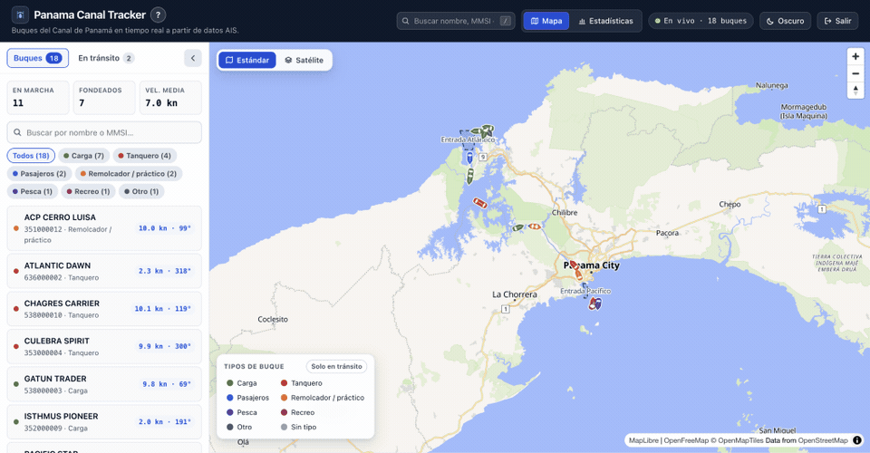
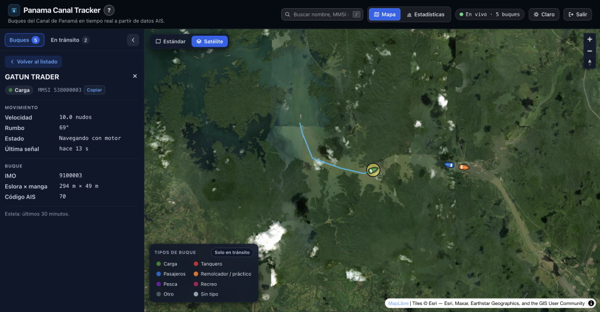
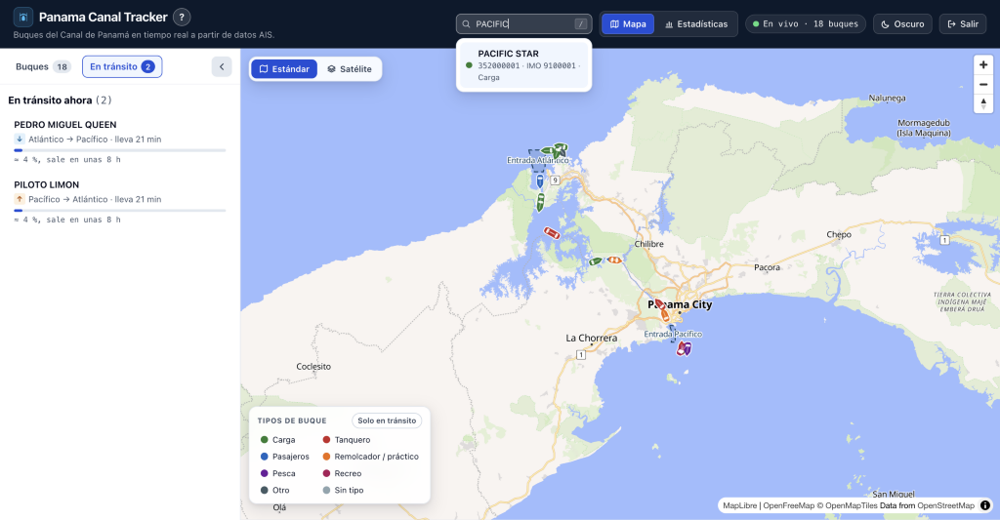
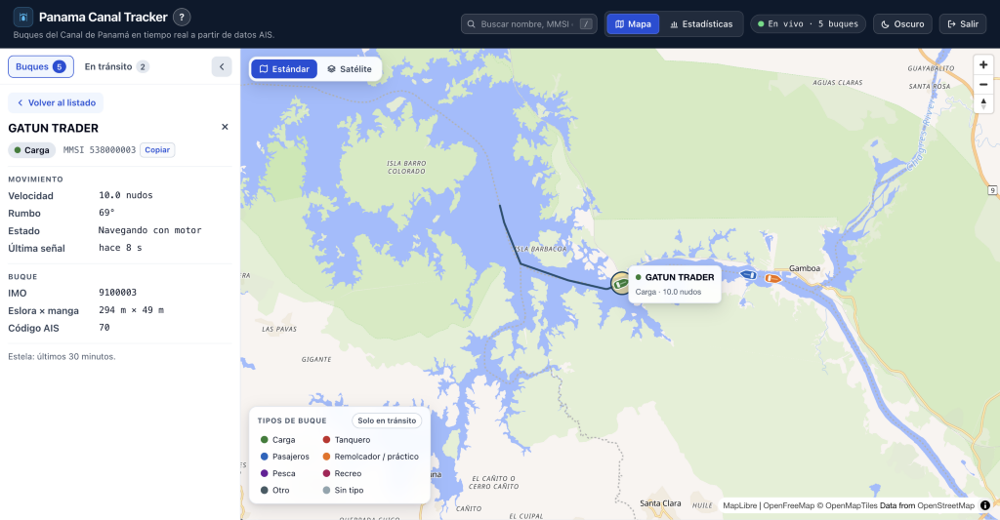
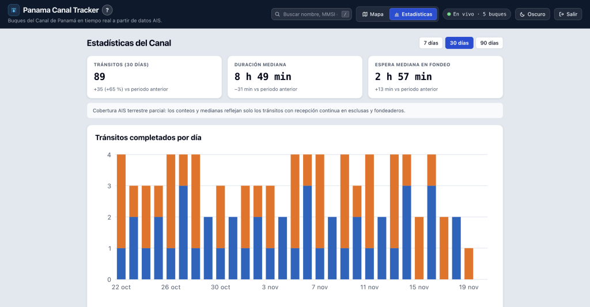
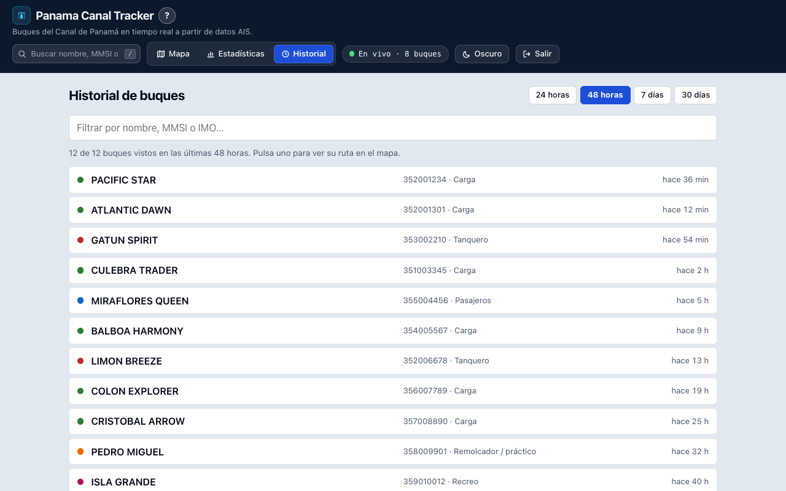
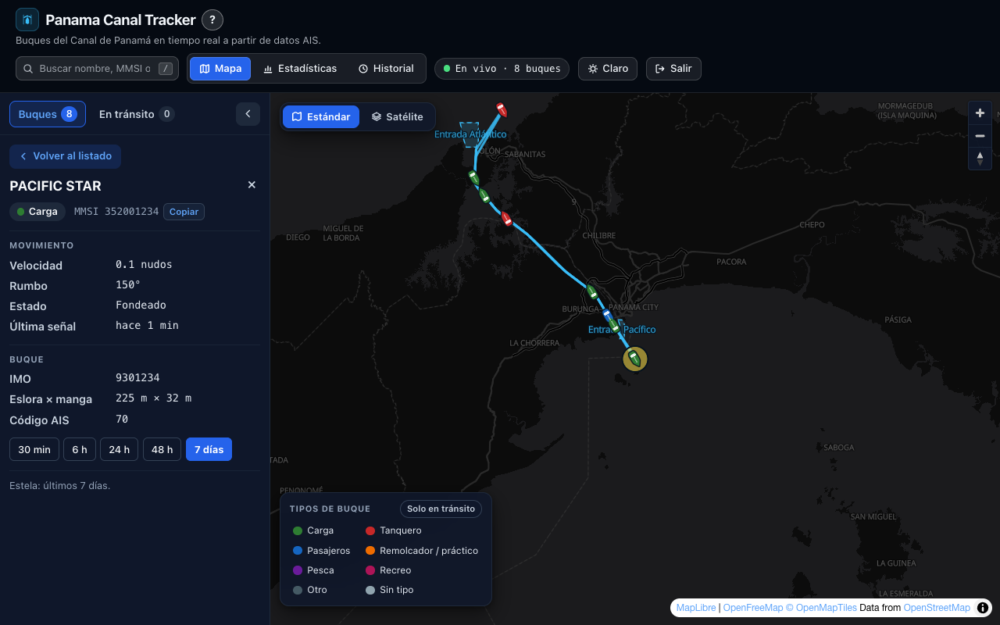
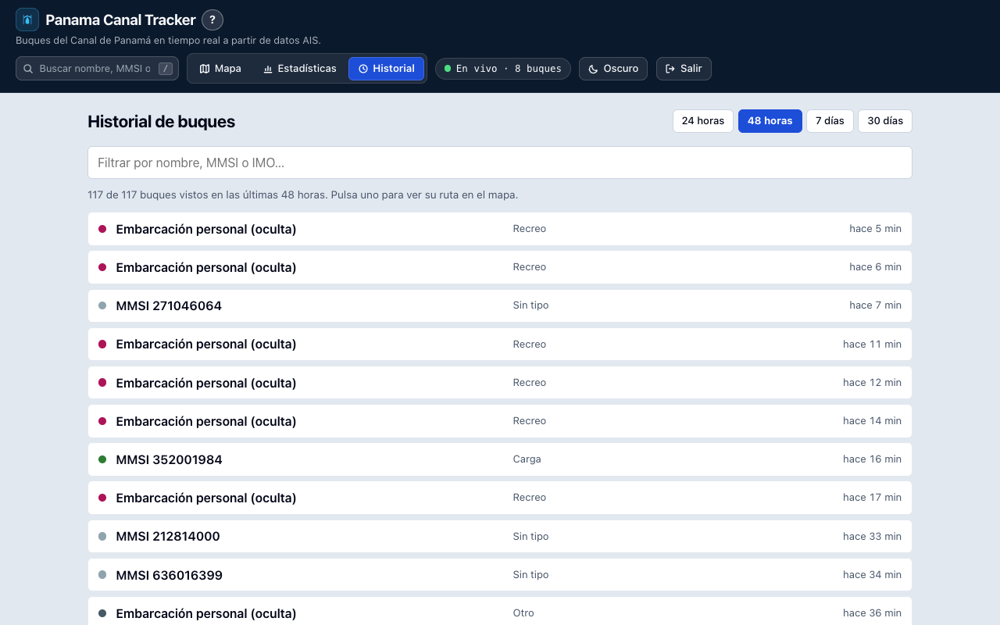
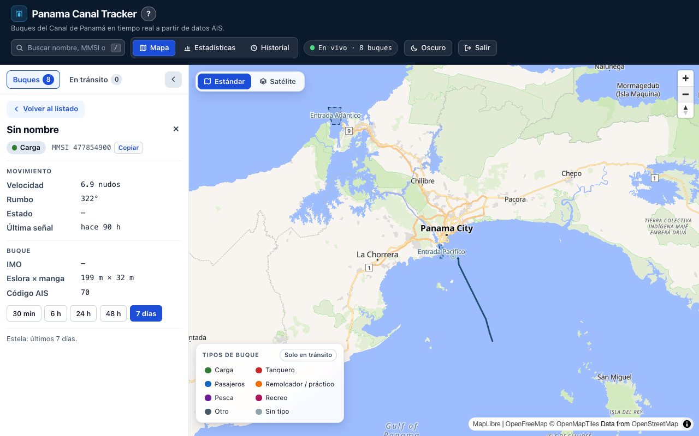
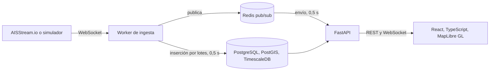

# Panama Canal Tracker

Seguimiento de los buques del Canal de Panamá a partir de datos AIS en vivo: ingiere el flujo AIS,
infiere los tránsitos y las esperas en fondeadero y los muestra en un mapa en tiempo real con
estadísticas e historial.

[English](README.md)

[](https://github.com/zSamir015/panama-canal-tracker/actions/workflows/ci.yml)
[](LICENSE)

[Demo en vivo](https://zsamir015.github.io/panama-canal-tracker/): la demo estática corre en el
navegador con buques simulados que siguen el eje real del Canal, o desde «Ver demo sin cuenta» en
la pantalla de acceso. No necesita clave de API ni backend.



## Resumen

No existe una fuente pública con los tránsitos oficiales del Canal. Este proyecto infiere los
tránsitos y las esperas en fondeadero a partir de señales AIS en bruto y dice con claridad dónde
termina esa inferencia: la cobertura terrestre gratuita de AIS dentro del Canal es parcial, así
que en la mayor parte del cauce no hay señal (ver [Datos y límites](#datos-y-límites)).

El sistema tiene tres partes:

- Un worker de ingesta que lee AIS de [AISStream.io](https://aisstream.io), valida y guarda las
  posiciones y ejecuta los detectores de tránsitos y de fondeo.
- Un servicio FastAPI que expone endpoints REST y un WebSocket con las posiciones en vivo.
- Un frontend React y MapLibre con el mapa en vivo, un panel de tránsitos, estadísticas y un
  historial.

## Estado

El proyecto está terminado. Las Fases 0 a 7 del [roadmap](docs/ROADMAP.md) están cerradas y
`v1.0.0` se publicó el 2026-11-20. Los cambios posteriores son mejoras pequeñas de la interfaz y de
las herramientas, y constan en *Unreleased* del [changelog](CHANGELOG.md).

Hay dos decisiones de alcance deliberadas:

- No hay entorno de producción ([ADR-0017](docs/adr/0017-v1-sin-entorno-de-produccion.md)). Se
  ejecuta como una pila local de `docker compose` y una demo estática en GitHub Pages. Lo que
  todavía exigiría un despliegue público está en [docs/SECURITY_REVIEW.md](docs/SECURITY_REVIEW.md).
- Los datos de AISStream no se enseñan a visitantes anónimos
  ([ADR-0008](docs/adr/0008-demo-con-login.md)): el mapa exige una cuenta y la demo pública usa
  datos simulados.

## Capturas

### Interfaz, con datos simulados

| Mapa claro y barra lateral | Tema oscuro y capa satelital |
| :---: | :---: |
|  |  |
| Cifras de la flota, filtros por tipo de buque y leyenda interactiva. | Esri World Imagery ([ADR-0018](docs/adr/0018-satelite-esri-world-imagery.md)), tema oscuro, últimos 30 minutos de estela y horas en `America/Panama`. |

| Buscador y progreso de tránsito | Tooltip al pasar el cursor |
| :---: | :---: |
|  |  |
| Búsqueda por nombre, MMSI o IMO (`/` o `⌘K`), URL compartible (`?mmsi=&view=`) y progreso estimado sobre la mediana de los tránsitos. | Nombre, tipo y velocidad al pasar el cursor; las señales de más de 15 minutos se atenúan. |

| Estadísticas (`?view=stats`) | Diseño móvil (`390×844`) |
| :---: | :---: |
|  |  |
| Cifras del periodo frente al anterior, aviso de cobertura AIS parcial y barras diarias por sentido. | Cabecera compacta y una hoja inferior que se puede arrastrar. |

### Historial y rutas, con datos simulados

| Historial (`?view=history`) | Ventana de la ruta |
| :---: | :---: |
|  |  |
| Buques con una posición en las últimas 24 h, 48 h, 7 o 30 días, el más reciente primero, con filtro por nombre, MMSI o IMO. Al elegir uno se abre en el mapa. | La ficha ofrece 30 min, 6 h, 24 h, 48 h y 7 días. La línea solo une posiciones recibidas y se corta en los huecos largos de señal. |

La pestaña Historial necesita la API, así que la demo estática no la incluye. Las capturas de arriba
usan buques simulados con nombres ficticios.

### Con datos AIS reales

| Historial, últimas 48 horas | Ruta de 7 días de un carguero |
| :---: | :---: |
|  |  |
| 117 buques reales. Los veleros, embarcaciones de recreo y pesqueros se enmascaran porque su nombre y MMSI pueden identificar a una persona. | Un carguero que llega al fondeadero del Pacífico desde el sureste. Solo se enseña la ruta de buques comerciales. |

Datos reales de [AISStream.io](https://aisstream.io), recogidos entre el 2026-11-07 y el 2026-11-22
por el worker local y el recolector de GitHub. La cobertura es parcial, así que el resultado es
escaso. Son imágenes estáticas ([ADR-0020](docs/adr/0020-capturas-con-datos-reales.md)).

## Funcionalidades

- Ingesta de mensajes AIS de Clase A y Clase B desde AISStream, escritos por lotes cada 0,5 s y
  publicados por Redis hacia el WebSocket.
- Mapa en tiempo real con los buques en una sola capa WebGL, mapas base vectorial y satelital, temas
  claro y oscuro y filtro por tipo de buque.
- Detección de tránsitos completos entre las entradas del Atlántico y del Pacífico, con sentido,
  progreso estimado y tiempo transcurrido ([ADR-0016](docs/adr/0016-sentido-de-entrada-por-rumbo.md)).
- Medida de la espera en los fondeaderos del Atlántico y del Pacífico antes de entrar.
- Estadísticas por periodo e historial con una ventana de ruta seleccionable de hasta 7 días.
- Búsqueda por nombre, MMSI o IMO y estado guardado en la URL.
- Controles accesibles: navegación entre vistas con las flechas, gestión del foco en los paneles y
  foco de teclado visible.
- Autenticación con tokens de acceso de vida corta y tokens de refresco rotativos en una cookie
  `HttpOnly`, una Content Security Policy estricta y una regla de lint que prohíbe insertar HTML.

## Arquitectura



El worker y la API son procesos distintos ([ADR-0004](docs/adr/0004-worker-separado-y-redis.md)),
de modo que la API puede escalar sin abrir más conexiones a AISStream; el worker es una única
instancia por diseño. Los detalles están en [docs/ARCHITECTURE.md](docs/ARCHITECTURE.md).

## Tecnología y calidad

| Capa | Tecnología |
|---|---|
| API y autenticación | Python 3.12, FastAPI (asíncrono), Pydantic v2, PyJWT, `pwdlib` (Argon2id) |
| Datos | PostgreSQL 16, PostGIS, TimescaleDB, SQLAlchemy 2.0 asíncrono, Alembic |
| Tiempo real | Worker WebSocket de AISStream, Redis pub/sub, `/ws/live` |
| Frontend | React 19, TypeScript (strict), Vite, MapLibre GL JS, TanStack Query |
| Operación | Docker Compose con contenedores sin root y de solo lectura, GitHub Actions, Prometheus `/metrics` |

Las comprobaciones corren en CI en cada pull request y deben pasar antes de fusionar: 1.147 tests
del backend (unitarios y de integración contra PostgreSQL y Redis reales), 274 del frontend,
`mypy --strict`, `ruff`, `eslint --max-warnings=0`, `pip-audit`, `npm audit`, `gitleaks` y la
construcción de las imágenes.

## Datos y límites

[docs/VALIDATION.md](docs/VALIDATION.md) compara el detector con AIS real durante 14,9 días
(2026-11-07 al 2026-11-21):

- El recolector escuchó 201,4 de 356,4 horas (56,5 %) y registró 10.040 posiciones de 595 buques.
- Solo 86 posiciones (0,9 %) cayeron dentro de las zonas de entrada y 26 dentro del corredor del
  Canal.
- El detector completó 2 tránsitos, frente a unos 520 esperados según la media de unos 35 diarios de
  la Autoridad del Canal.

Esa diferencia mide la cobertura de AISStream en Panamá, no la precisión del detector, y el estudio
concluye que los datos no permiten calibrar los umbrales. La lógica de tránsitos y fondeo se
verifica con el simulador y con trayectorias sintéticas. Por eso el mapa en vivo enseña pocos buques
y las estadísticas, que solo cuentan tránsitos completados, quedan casi vacías.

Una prueba de carga del WebSocket con 500 clientes simultáneos ([docs/LOAD_TEST.md](docs/LOAD_TEST.md))
los conectó a todos sin fallos y con una latencia mediana del snapshot de 9 ms (percentil 95: 11 ms).
La ingesta siguió funcionando bajo carga: 9,5 filas/s frente a una referencia de 10,6.

## Ejecución

La pila completa (PostgreSQL, Redis, migraciones, API, worker y un simulador con 18 buques) corre en
contenedores sin ninguna clave externa:

```bash
cp .env.example .env            # rellenar contraseñas aleatorias y JWT_SECRET_KEY; nunca subir .env
AISSTREAM_URL=ws://simulator:8765 AISSTREAM_API_KEY=simulator \
  docker compose -f docker-compose.stack.yml --profile simulator up -d --build --wait
# Documentación de la API: http://localhost:8000/docs (registrarse, iniciar sesión y GET /api/v1/vessels)
docker compose -f docker-compose.stack.yml --profile simulator down   # parar; con -v borra los datos
```

Con una clave real de AISStream, define `AISSTREAM_API_KEY` en `.env` y omite las variables y el
perfil del simulador. Para desarrollar en el equipo, las copias de seguridad, el worker de macOS y la
carga de datos recolectados, ver [docs/OPERATIONS.md](docs/OPERATIONS.md).

## Documentación

[docs/README.md](docs/README.md) es el índice. Los documentos principales:

| Documento | Contenido |
|---|---|
| [docs/ARCHITECTURE.md](docs/ARCHITECTURE.md) | Componentes, flujo de datos, modelo de datos y lógica de dominio |
| [docs/API_DESIGN.md](docs/API_DESIGN.md) | Contrato REST y WebSocket |
| [docs/OPERATIONS.md](docs/OPERATIONS.md) | Cómo ejecutar, comprobar y mantener el sistema |
| [docs/VALIDATION.md](docs/VALIDATION.md) | Estudio con AIS real: qué se puede y qué no se puede concluir |
| [docs/SECURITY_REVIEW.md](docs/SECURITY_REVIEW.md) | Revisión de seguridad final y lo que exigiría un despliegue |
| [docs/adr/](docs/adr/README.md) | Decisiones de arquitectura ([0001](docs/adr/0001-stack-tecnico.md) a [0020](docs/adr/0020-capturas-con-datos-reales.md)) |
| [docs/ENGINEERING.md](docs/ENGINEERING.md) | Convenciones de código, pruebas, seguridad y flujo de trabajo |

Este README existe en inglés y en español; el resto de la documentación está en español.

## Proceso de desarrollo

Cada cambio es un issue, una rama y un pull request, con las decisiones de arquitectura registradas
como ADR y una entrada del changelog por versión. Historial: [issues](https://github.com/zSamir015/panama-canal-tracker/issues),
[pull requests fusionados](https://github.com/zSamir015/panama-canal-tracker/pulls?q=is%3Apr+is%3Amerged),
[releases](https://github.com/zSamir015/panama-canal-tracker/releases) y el
[changelog](CHANGELOG.md).

## Seguridad

Para informar de una vulnerabilidad, ver [SECURITY.md](SECURITY.md); la revisión está en
[docs/SECURITY_REVIEW.md](docs/SECURITY_REVIEW.md).

## Licencia

Todos los derechos reservados. El código es público para poder leerlo y evaluarlo; usarlo,
copiarlo o modificarlo requiere permiso por escrito. Ver [LICENSE](LICENSE).
