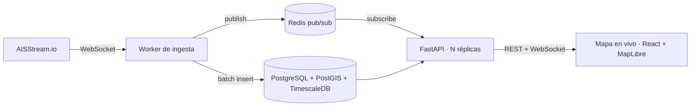

# Panama Canal Tracker

> Seguimiento en tiempo real de los buques que transitan el Canal de Panamá: ingesta AIS en vivo,
> detección automática de tránsitos y esperas en fondeo, y un mapa en vivo.

[English](README.md)

[](https://github.com/zSamir015/panama-canal-tracker/actions/workflows/ci.yml)
[](LICENSE)

<!-- GIF de la demo (Fase 4): docs/media/live-map.gif -->

## Qué hace

- 📡 **Ingiere** posiciones AIS en vivo del área del Canal desde [AISStream.io](https://aisstream.io)
- 🗺️ **Muestra** cada buque moviéndose en un mapa en tiempo real (React + MapLibre GL)
- 🔍 **Detecta** tránsitos completos (Atlántico ↔ Pacífico) con sentido y duración
- ⏱️ **Mide** cuánto esperan los buques en fondeo antes de entrar al Canal
- 📊 **Expone** estadísticas mediante una API REST documentada y un stream WebSocket
- 🔐 **Protege** el acceso con JWT (access + refresh con rotación) y roles

No existe una API pública con los datos oficiales de tránsitos del Canal. Este proyecto
**infiere** tránsitos y tiempos de espera a partir de señales AIS y valida los resultados contra
estadísticas públicas de la Autoridad del Canal de Panamá.

## Arquitectura



El worker y la API son procesos separados: la API escala horizontalmente manteniendo una sola
conexión a AISStream. Detalle en [docs/ARCHITECTURE.md](docs/ARCHITECTURE.md).

## Stack

| Capa | Tecnología |
|---|---|
| API | Python 3.12, FastAPI (async), Pydantic v2 |
| Datos | PostgreSQL 16, PostGIS, TimescaleDB, SQLAlchemy 2.0 async, Alembic |
| Tiempo real | Worker WebSocket AIS, Redis pub/sub, fan-out por WebSocket |
| Frontend | React, TypeScript, Vite, MapLibre GL JS |
| Auth | JWT (PyJWT), Argon2id (pwdlib) |
| Calidad | pytest, httpx, ruff, mypy, Vitest |
| Operación | Docker Compose, GitHub Actions, métricas Prometheus |

## Estado del proyecto

| Fase | Alcance | Estado |
|---|---|---|
| 0 | Scaffold y documentación | ✅ |
| 1 | Esqueleto FastAPI, CI, seguridad del repo | ✅ |
| 2 | Base de datos y autenticación | ✅ |
| 3 | Worker de ingesta AIS | ⏳ |
| 4 | Mapa en tiempo real y demo | ⏳ |
| 5 | Detección de tránsitos y validación | ⏳ |
| 6 | Esperas en fondeo y estadísticas | ⏳ |
| 7 | Endurecimiento para producción | ⏳ |

Plan completo: [docs/ROADMAP.md](docs/ROADMAP.md).

## Inicio rápido (disponible desde la Fase 3)

```bash
cp .env.example .env            # completar valores; nunca commitear .env
docker compose up -d            # db + redis + api + worker
python scripts/ais_simulator.py # opcional: buques simulados, sin API key
```

## Licencia

[MIT](LICENSE)
