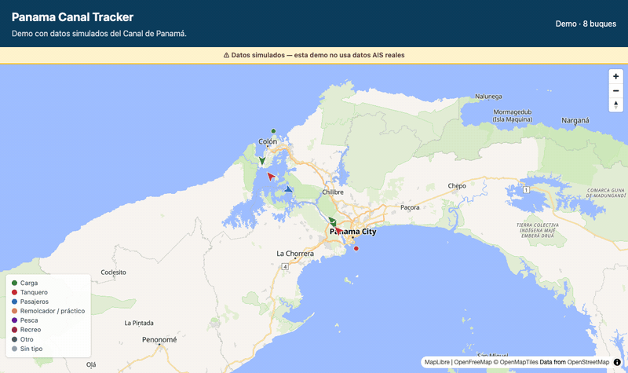
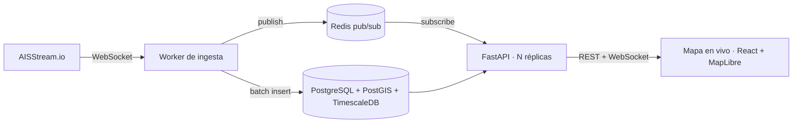

# Panama Canal Tracker

> Seguimiento en tiempo real de los buques que transitan el Canal de Panamá: ingesta AIS en vivo,
> detección automática de tránsitos y esperas en fondeo, y un mapa en vivo.

[English](README.md)

[](https://github.com/zSamir015/panama-canal-tracker/actions/workflows/ci.yml)
[](LICENSE)

**[Demo en vivo](https://zsamir015.github.io/panama-canal-tracker/)**: corre en el navegador con
datos simulados (sin backend ni datos AIS).



## Qué hace

- 📡 **Ingiere** posiciones AIS en vivo del área del Canal desde [AISStream.io](https://aisstream.io)
- 🗺️ **Muestra** cada buque moviéndose en un mapa en tiempo real (React + MapLibre GL)
- 🔍 **Detecta** tránsitos completos (Atlántico ↔ Pacífico) con sentido y duración
- ⏱️ **Mide** cuánto esperan los buques en fondeo antes de entrar al Canal
- 📊 **Expone** estadísticas mediante una API REST documentada y un stream WebSocket
- 🔐 **Protege** el acceso con JWT (access + refresh con rotación) y roles

No existe una API pública con los datos oficiales de tránsitos del Canal. Este proyecto
**infiere** tránsitos y tiempos de espera a partir de señales AIS y valida los resultados contra
estadísticas públicas de la Autoridad del Canal de Panamá.

## Arquitectura



El worker y la API son procesos separados: la API escala horizontalmente manteniendo una sola
conexión a AISStream. Detalle en [docs/ARCHITECTURE.md](docs/ARCHITECTURE.md).

## Stack

| Capa | Tecnología |
|---|---|
| API | Python 3.12, FastAPI (async), Pydantic v2 |
| Datos | PostgreSQL 16, PostGIS, TimescaleDB, SQLAlchemy 2.0 async, Alembic |
| Tiempo real | Worker WebSocket AIS, Redis pub/sub, fan-out por WebSocket |
| Frontend | React, TypeScript, Vite, MapLibre GL JS |
| Auth | JWT (PyJWT), Argon2id (pwdlib) |
| Calidad | pytest, httpx, ruff, mypy, Vitest |
| Operación | Docker Compose, GitHub Actions, métricas Prometheus |

## Estado del proyecto

| Fase | Alcance | Estado |
|---|---|---|
| 0 | Scaffold y documentación | ✅ |
| 1 | Esqueleto FastAPI, CI, seguridad del repo | ✅ |
| 2 | Base de datos y autenticación | ✅ |
| 3 | Worker de ingesta AIS | ✅ |
| 4 | Mapa en tiempo real y demo | ✅ |
| 5 | Detección de tránsitos y validación | ⏳ |
| 6 | Esperas en fondeo y estadísticas | ✅ |
| 7 | Endurecimiento para producción | ⏳ |

La fase 6 se cierra con datos sintéticos. La fase 5 sigue abierta hasta validar el detector con
tráfico real (tarea 5.7), así que los umbrales de las estadísticas siguen siendo estimaciones.

Plan completo: [docs/ROADMAP.md](docs/ROADMAP.md).

## Inicio rápido

Toda la pila (PostgreSQL, Redis, migraciones, API y worker AIS) corre en contenedores. No hace
falta API key de AISStream: un simulador reproduce tráfico realista del Canal.

```bash
cp .env.example .env            # contraseñas aleatorias y JWT_SECRET_KEY; nunca commitear .env
AISSTREAM_URL=ws://simulator:8765 AISSTREAM_API_KEY=simulador \
  docker compose -f docker-compose.stack.yml --profile simulator up -d --build --wait
# Documentación de la API: http://localhost:8000/docs (registro, login y GET /api/v1/vessels)
docker compose -f docker-compose.stack.yml --profile simulator down   # parar (-v borra los datos)
```

Con una key real, ponla en `AISSTREAM_API_KEY` dentro de `.env` y quita las variables y el
perfil del simulador. Para desarrollar (API en el host con `--reload`), ver
[AGENTS.md](AGENTS.md#10-comandos-útiles).

## Cómo se construyó

El proyecto sigue un plan escrito y deja registrada cada decisión no obvia, de modo que su
historia se puede leer en orden:

- **El plan**: [docs/ROADMAP.md](docs/ROADMAP.md) recoge cada fase y tarea con sus criterios de
  aceptación. Las fases se construyeron en orden, una tarea cada vez, y cada fase se cierra con una
  etiqueta.
- **Las decisiones**: cada decisión de arquitectura tiene su registro en [docs/adr/](docs/adr/) con
  el contexto, las alternativas descartadas y las consecuencias:

| ADR | Decisión |
|---|---|
| [0001](docs/adr/0001-stack-tecnico.md) | Stack técnico |
| [0002](docs/adr/0002-fuente-de-datos-ais.md) | AISStream.io como fuente de datos AIS |
| [0003](docs/adr/0003-librerias-de-autenticacion.md) | PyJWT y pwdlib (Argon2id) para autenticación |
| [0004](docs/adr/0004-worker-separado-y-redis.md) | Worker de ingesta como proceso separado y Redis pub/sub |
| [0005](docs/adr/0005-timescaledb-para-posiciones.md) | TimescaleDB para la serie temporal de posiciones |
| [0006](docs/adr/0006-mapa-web-maplibre.md) | Mapa en tiempo real con React + MapLibre GL en el mismo repositorio |
| [0007](docs/adr/0007-rate-limiting.md) | Librería de rate limiting |
| [0008](docs/adr/0008-demo-con-login.md) | Datos de AISStream solo para usuarios con sesión |
| [0009](docs/adr/0009-segunda-conexion-destinos-al-canal.md) | Segunda conexión a AISStream para buques con destino al Canal |
| [0010](docs/adr/0010-tiles-openfreemap.md) | Tiles del mapa con OpenFreeMap |
| [0011](docs/adr/0011-demo-estatica-github-pages.md) | Demo estática en GitHub Pages |
| [0012](docs/adr/0012-recolector-ais-en-github-actions.md) | Recolector AIS en GitHub Actions |
| [0013](docs/adr/0013-estadisticas-con-sql-y-agregados-sobre-posiciones.md) | Las estadísticas de tránsitos usan SQL; los agregados continuos, las posiciones |
| [0014](docs/adr/0014-metricas-con-token-y-exposicion-manual.md) | `/metrics` con token propio y formato de Prometheus escrito a mano |
| [0015](docs/adr/0015-copias-logicas-cifradas-con-gpg.md) | Copias lógicas cifradas con `pg_dump` y `gpg` |
| [0016](docs/adr/0016-sentido-de-entrada-por-rumbo.md) | El rumbo (COG) decide si un buque entra o sale por una zona de entrada |

- **El trabajo**: cada tarea es un pull request con lo que cambia, por qué, cómo se probó y una
  lista de comprobación de seguridad: [pull requests fusionados](https://github.com/zSamir015/panama-canal-tracker/pulls?q=is%3Apr+is%3Amerged),
  [issues](https://github.com/zSamir015/panama-canal-tracker/issues).
- **Las versiones**: una etiqueta anotada por fase cerrada, de `v0.1.0` a `v0.4.0` por ahora
  ([etiquetas](https://github.com/zSamir015/panama-canal-tracker/tags)). El registro de cambios
  está en [CHANGELOG.md](CHANGELOG.md).
- **Lo que sigue abierto**: los resultados de validar el detector con tráfico real (tarea 5.7)
  todavía no están publicados, porque hacen falta días de datos AIS grabados; hasta entonces, los
  umbrales y los polígonos son estimaciones. Tampoco existe el despliegue de producción (proxy
  inverso, copias programadas); [docs/SECURITY_REVIEW.md](docs/SECURITY_REVIEW.md) lista lo que
  falta.

## Licencia

[MIT](LICENSE)
