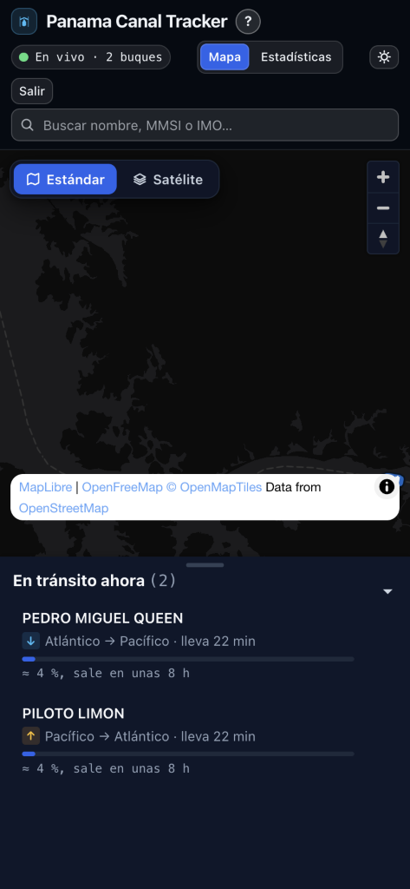
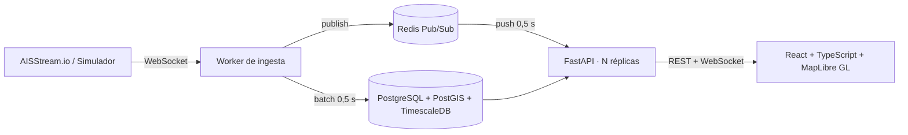

# Panama Canal Tracker

> Seguimiento en tiempo real de los buques que cruzan el Canal de Panamá: ingesta AIS Clase A/B en
> vivo, detección automática de tránsitos y esperas en fondeo, mapa satelital/vectorial y analítica.

[English](README.md)

[](https://github.com/zSamir015/panama-canal-tracker/actions/workflows/ci.yml)
[](LICENSE)

**[Demo en vivo](https://zsamir015.github.io/panama-canal-tracker/)**: corre directo en el navegador
con trayectorias simuladas sobre el eje real del Canal (también accesible desde «Ver demo sin
cuenta» en el login, sin backend ni API key).


---

## Recorrido visual y capacidades principales

### Navegación en tiempo real (Consola OLED Oscura + Satélite Esri)
Todas las trayectorias del simulador y la demo siguen el cauce navegable real de OpenStreetMap por
Bahía Limón, Esclusas de Gatún, Lago Gatún, Corte Culebra y Balboa sin cruzar tierra. Las siluetas
navales direccionales con puente blanco se combinan con balizas compactas en fondeaderos y escala
adaptativa según el zoom.


### Galería de funcionalidades

| Mapa claro y barra operativa de escritorio | Modo oscuro OLED y capa satelital |
| :---: | :---: |
|  |  |
| *Flota de 18 buques en vivo, KPIs operativos en barra lateral, filtros por tipo y leyenda interactiva* | *Esri World Imagery (`ADR-0018`), tema oscuro OLED, estela de 30 min, «Copiar MMSI» y hora `America/Panama`* |

| Buscador global (`/`, `⌘K`) y progreso de tránsito | Tooltip de escritorio y escala según zoom |
| :---: | :---: |
|  |  |
| *Buscador por nombre, MMSI o IMO, estado sincronizado en URL (`?mmsi=&view=`) y progreso estimado sobre la mediana* | *Tooltip de escritorio (`nombre · tipo · velocidad`), atenuación de señal antigua (>15 min) y balizas compactas* |

| Estadísticas del Canal (`?view=stats`) | Vista móvil (`390×844`) y hoja arrastrable |
| :---: | :---: |
|  |  |
| *Tarjetas KPI con variación vs periodo anterior, aviso honesto de cobertura AIS parcial y barras apiladas por sentido* | *Corrección `100dvh` para iOS Safari, cabecera compacta y hoja inferior táctil arrastrable (`useSheetDrag`)* |

---

## Qué hace

- 📡 **Ingiere** mensajes AIS Clase A y Clase B (`PositionReport`, `StandardClassBPositionReport`,
  `ExtendedClassBPositionReport`, `StaticDataReport` y `ShipStaticData`) desde
  [AISStream.io](https://aisstream.io) con volcado por lotes y difusión WebSocket cada `0,5 s`
- 🗺️ **Muestra** todos los buques en una sola capa WebGL GeoJSON (React + MapLibre GL) con cascos
  navales direccionales, capas **Estándar / Satélite**, tema claro/oscuro (`prefers-color-scheme`)
  y atenuación de señales antiguas
- 🔍 **Detecta** tránsitos completos (Atlántico ↔ Pacífico) con sentido (`↓`/`↑`), barra de progreso
  estimada, duración y medianas históricas
- ⏱️ **Mide** esperas en los fondeaderos Atlántico y Pacífico antes de entrar al Canal
- 📊 **Expone** analítica REST y flujo WebSocket en vivo sobre TimescaleDB + PostGIS
- ♿ **UX y accesibilidad**: pestañas WAI-ARIA (`tablist`/`tab`) con flechas, gestión automática de
  foco en fichas, buscador `/` y `⌘K`, URL compartible, conmutador de contraseña, botones `Reintentar`
  en español y tipografía monoespaciada tabular (`--font-mono`)
- 🔐 **Seguridad endurecida**: JWT con rotación de refresh cookies HttpOnly (`Argon2id`), CSP estricto
  y regla ESLint que prohíbe `dangerouslySetInnerHTML`

No existe una API pública oficial con los tránsitos del Canal. Este proyecto **infiere** tránsitos y
esperas desde señales AIS y comunica de forma transparente la cobertura terrestre parcial tanto en
estados vacíos como en estadísticas.

## Arquitectura



El worker y la API son procesos independientes: la API escala horizontalmente manteniendo una única
conexión AIS aguas arriba. Detalles en [docs/ARCHITECTURE.md](docs/ARCHITECTURE.md).

## Stack técnico y calidad

| Capa | Tecnología y verificación |
|---|---|
| API y Auth | Python 3.12, FastAPI (async), Pydantic v2, PyJWT, `pwdlib` (Argon2id) |
| Datos y Geo | PostgreSQL 16, PostGIS, TimescaleDB, SQLAlchemy 2.0 async, Alembic |
| Tiempo real | Worker WebSocket AIS Clase A/B (`0,5 s`), Redis pub/sub, `/ws/live` |
| Frontend | React 19, TypeScript estricto, Vite, MapLibre GL JS (WebGL), TanStack Query |
| Calidad | **797** tests unitarios backend (`pytest -m "not integration"`), **247** tests frontend (`Vitest`), `mypy --strict`, `ruff`, `eslint --max-warnings=0`, `pip-audit`, `gitleaks` |
| Operación | Docker Compose endurecido (no-root), GitHub Actions (7 checks CI), métricas Prometheus |

## Estado del proyecto

| Fase | Alcance | Estado |
|---|---|---|
| 0 | Scaffold y documentación | ✅ |
| 1 | Esqueleto FastAPI, CI, seguridad del repo | ✅ |
| 2 | Base de datos y autenticación | ✅ |
| 3 | Worker de ingesta AIS | ✅ |
| 4 | Mapa en tiempo real y demo | ✅ |
| 5 | Detección de tránsitos y validación | ✅ |
| 6 | Esperas en fondeo y estadísticas | ✅ |
| 7 | Endurecimiento para producción y mejoras UI/UX | ✅ (listo para `v1.0.0`; sin despliegue productivo gestionado según [ADR-0017](docs/adr/0017-v1-sin-entorno-de-produccion.md)) |

Las fases 0 a 7 están completas y listas para `v1.0.0`.

## Resultados de validación y carga

- **Validación con AIS real ([docs/VALIDATION.md](docs/VALIDATION.md))**: durante **12,5 días**
  (`2026-11-07` al `2026-11-19`, `29` ejecuciones del recolector equivalentes a `156,3 h / 299,4 h`,
  el `52,2 %`), se registraron **8.286 posiciones** de **500 buques**, **304 visitas a fondeo**
  (`267` en Pacífico, `37` en Atlántico) y **2 tránsitos completos** (`18 h 48 min` y `10 h 08 min` en
  sentido sur) frente a `~437` esperados (`~35/día` de media ACP). Solo `84` posiciones (`1,0 %`)
  cayeron en las entradas y `25` en Culebra / Miraflores, confirmando que la cobertura terrestre
  gratuita de AISStream dentro del Canal es parcial mientras `2.578` posiciones paradas quedan fuera de
  los polígonos iniciales de fondeo. Los umbrales siguen calibrados sobre trayectorias sintéticas
  sobre OSM, mientras `ADR-0019` y `scripts/ais_coverage.py` (`#165`, `#169`) amplían las horas de
  escucha y miden la recepción Tipo 27 / caja ampliada.
- **Prueba de carga WebSocket `/ws/live` ([docs/LOAD_TEST.md](docs/LOAD_TEST.md))**: con **500 clientes
  WebSocket simultáneos** frente a FastAPI + Redis + TimescaleDB (Apple M5 10 núcleos, simulador a
  `--speed 60`), conectaron **500/500** y recibieron el snapshot inicial con **0 fallos** (`9 ms` p50 /
  `11 ms` p95 / `37 ms` máx.), `17.466` mensajes entregados (cadencia p50 de `2,00 s`), **7,8 % media /
  10,9 % pico** de CPU en la API, **153 MB** de memoria máxima y sin degradación en ingesta
  (`10,63 filas/s` sin carga frente a `9,52 filas/s` con 500 clientes).

## Cómo se construyó

Construido estrictamente fase por fase (`un issue = una rama = un PR`) con decisiones de arquitectura
documentadas en ADRs:

- **Hoja de ruta e hitos**: [docs/ROADMAP.md](docs/ROADMAP.md) (Fases `0`–`7` y criterios de aceptación)
- **Decisiones técnicas clave (`docs/adr/`)**: worker AIS separado + Redis pub/sub (`ADR-0004`),
  hipertablas TimescaleDB + PostGIS (`ADR-0005`), renderizado WebGL GeoJSON (`ADR-0006`), Argon2id +
  PyJWT (`ADR-0003`), demo estática en GitHub Pages (`ADR-0011`), analítica SQL en TimescaleDB
  (`ADR-0013`), copias cifradas con GPG (`ADR-0015`), capa satelital Esri World Imagery (`ADR-0018`), y
  recolector continuo encadenado junto al worker `launchd` en macOS dentro del límite de 2 sockets
  (`ADR-0012`, `ADR-0019`). Índice completo:
  [0001](docs/adr/0001-stack-tecnico.md)–[0019](docs/adr/0019-recolector-continuo-y-worker-a-la-vez.md).
- **Línea base de seguridad**: [docs/SECURITY_REVIEW.md](docs/SECURITY_REVIEW.md) y [SECURITY.md](SECURITY.md)
- **Historial en GitHub**: [Issues](https://github.com/zSamir015/panama-canal-tracker/issues) ·
  [PRs fusionados](https://github.com/zSamir015/panama-canal-tracker/pulls?q=is%3Apr+is%3Amerged) ·
  [Releases (`v0.1.0`–`v0.6.0`)](https://github.com/zSamir015/panama-canal-tracker/releases) ·
  [CHANGELOG.md](CHANGELOG.md)

## Inicio rápido

Toda la pila (PostgreSQL, Redis, migraciones, API, worker AIS y simulador de 18 buques a velocidad
`2×`) corre en contenedores sin API key:

```bash
cp .env.example .env            # contraseñas aleatorias y JWT_SECRET_KEY; nunca commitear .env
AISSTREAM_URL=ws://simulator:8765 AISSTREAM_API_KEY=simulator \
  docker compose -f docker-compose.stack.yml --profile simulator up -d --build --wait
# Documentación de la API: http://localhost:8000/docs (registro, login y GET /api/v1/vessels)
docker compose -f docker-compose.stack.yml --profile simulator down   # parar (-v borra los datos)
```

Con una clave real de AISStream.io, añádela en `AISSTREAM_API_KEY` dentro de `.env` y omite las
variables y el perfil `--profile simulator`. Para desarrollo local con `--reload`, consulta
[AGENTS.md](AGENTS.md#10-comandos-útiles).

## Documentación

| Documento | Contenido |
|---|---|
| [docs/ARCHITECTURE.md](docs/ARCHITECTURE.md) | Componentes, flujo de datos y modelo de datos |
| [docs/ROADMAP.md](docs/ROADMAP.md) | Fases y criterios de aceptación |
| [docs/API_DESIGN.md](docs/API_DESIGN.md) | Contrato REST y WebSocket |
| [docs/DATA_SOURCES.md](docs/DATA_SOURCES.md) | Fuente AIS, límites y zonas geográficas |
| [docs/LOAD_TEST.md](docs/LOAD_TEST.md) | Prueba de carga WebSocket (500 clientes) |
| [docs/VALIDATION.md](docs/VALIDATION.md) | Estudio de 12,5 días de cobertura AIS real |
| [docs/SECURITY_REVIEW.md](docs/SECURITY_REVIEW.md) | Revisión de seguridad y requisitos previos a producción |
| [docs/AIS_COLLECTOR.md](docs/AIS_COLLECTOR.md) | Flujo continuo del recolector AIS en GitHub Actions |
| [docs/LOCAL_WORKER_MAC.md](docs/LOCAL_WORKER_MAC.md) | Worker estable en macOS con `launchd` y `caffeinate` |
| [docs/adr/](docs/adr/) | Architecture Decision Records ([0001](docs/adr/0001-stack-tecnico.md)–[0019](docs/adr/0019-recolector-continuo-y-worker-a-la-vez.md)) |
| [AGENTS.md](AGENTS.md) | Convenciones de ingeniería y seguridad |
| [SECURITY.md](SECURITY.md) | Cómo reportar una vulnerabilidad |

## Licencia

Todos los derechos reservados. El código es público para que se pueda ver y evaluar; usarlo, copiarlo o modificarlo requiere permiso por escrito. Ver [LICENSE](LICENSE).
