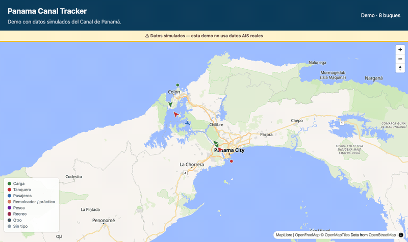
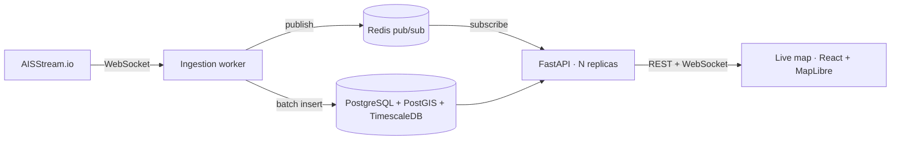

# Panama Canal Tracker

> Real-time tracking of vessels transiting the Panama Canal: live AIS ingestion, automatic
> transit and anchorage-wait detection, and a live map.

[Español](README.es.md)

[](https://github.com/zSamir015/panama-canal-tracker/actions/workflows/ci.yml)
[](LICENSE)

**[Live demo](https://zsamir015.github.io/panama-canal-tracker/)** — runs in the browser on simulated
data (no backend, no AIS feed).



## What it does

- 📡 **Ingests** live AIS positions over the Canal area from [AISStream.io](https://aisstream.io)
- 🗺️ **Shows** every vessel moving on a real-time map (React + MapLibre GL)
- 🔍 **Detects** complete transits (Atlantic ↔ Pacific) with direction and duration
- ⏱️ **Measures** how long ships wait at anchor before entering the Canal
- 📊 **Exposes** statistics through a documented REST API and a WebSocket stream
- 🔐 **Secures** access with JWT (access + rotating refresh tokens) and roles

There is no public API for official Canal transit data. This project **infers** transits and
waiting times from raw AIS signals, and validates the results against public Panama Canal
Authority statistics.

## Architecture



The ingestion worker and the API are separate processes, so the API scales horizontally while
keeping a single upstream AIS connection. Details in [docs/ARCHITECTURE.md](docs/ARCHITECTURE.md).

## Tech stack

| Layer | Technology |
|---|---|
| API | Python 3.12, FastAPI (async), Pydantic v2 |
| Data | PostgreSQL 16, PostGIS, TimescaleDB, SQLAlchemy 2.0 async, Alembic |
| Real time | AIS WebSocket worker, Redis pub/sub, WebSocket fan-out |
| Frontend | React, TypeScript, Vite, MapLibre GL JS |
| Auth | JWT (PyJWT), Argon2id (pwdlib) |
| Quality | pytest, httpx, ruff, mypy, Vitest |
| Ops | Docker Compose, GitHub Actions, Prometheus metrics |

## Project status

| Phase | Scope | Status |
|---|---|---|
| 0 | Scaffold and documentation | ✅ |
| 1 | FastAPI skeleton, CI, repo security | ✅ |
| 2 | Database and authentication | ✅ |
| 3 | AIS ingestion worker | ✅ |
| 4 | Real-time map and live demo | ✅ |
| 5 | Transit detection and validation | ⏳ |
| 6 | Anchorage waits and statistics | ⏳ |
| 7 | Production hardening | ⏳ |

Full plan: [docs/ROADMAP.md](docs/ROADMAP.md).

## Quick start

The whole stack (PostgreSQL, Redis, migrations, API and AIS worker) runs in containers. No
AISStream API key is needed: a simulator replays realistic canal traffic.

```bash
cp .env.example .env            # fill in random passwords and JWT_SECRET_KEY; never commit .env
AISSTREAM_URL=ws://simulator:8765 AISSTREAM_API_KEY=simulator \
  docker compose -f docker-compose.stack.yml --profile simulator up -d --build --wait
# API docs: http://localhost:8000/docs (register, log in, then GET /api/v1/vessels)
docker compose -f docker-compose.stack.yml --profile simulator down   # stop (add -v to wipe data)
```

With a real key, set `AISSTREAM_API_KEY` in `.env` and drop the simulator variables and profile.
For development (API on the host with `--reload`), see [AGENTS.md](AGENTS.md#10-comandos-útiles).

## Documentation

| Document | Content |
|---|---|
| [docs/ARCHITECTURE.md](docs/ARCHITECTURE.md) | Components, data flow, data model |
| [docs/ROADMAP.md](docs/ROADMAP.md) | Phases with acceptance criteria |
| [docs/API_DESIGN.md](docs/API_DESIGN.md) | REST and WebSocket contract |
| [docs/DATA_SOURCES.md](docs/DATA_SOURCES.md) | AIS source, limits, geographic zones |
| [docs/LOAD_TEST.md](docs/LOAD_TEST.md) | WebSocket load test: 500 clients, results and method |
| [docs/adr/](docs/adr/) | Architecture decision records |
| [AGENTS.md](AGENTS.md) | Engineering and security conventions for this repository |
| [SECURITY.md](SECURITY.md) | How to report a vulnerability |

## How it was built

The project follows a written plan and records every non-obvious decision, so the history can be
read in order:

- **The plan**: [docs/ROADMAP.md](docs/ROADMAP.md) lists every phase and task with its acceptance
  criteria. Phases were built in order, one task at a time, and a phase is closed with a tag.
- **The decisions**: each architecture decision has a record in [docs/adr/](docs/adr/) (in Spanish)
  with its context, the alternatives that were rejected and the consequences:

| ADR | Decision |
|---|---|
| [0001](docs/adr/0001-stack-tecnico.md) | Stack técnico |
| [0002](docs/adr/0002-fuente-de-datos-ais.md) | AISStream.io como fuente de datos AIS |
| [0003](docs/adr/0003-librerias-de-autenticacion.md) | PyJWT y pwdlib (Argon2id) para autenticación |
| [0004](docs/adr/0004-worker-separado-y-redis.md) | Worker de ingesta como proceso separado y Redis pub/sub |
| [0005](docs/adr/0005-timescaledb-para-posiciones.md) | TimescaleDB para la serie temporal de posiciones |
| [0006](docs/adr/0006-mapa-web-maplibre.md) | Mapa en tiempo real con React + MapLibre GL en el mismo repositorio |
| [0007](docs/adr/0007-rate-limiting.md) | Librería de rate limiting |
| [0008](docs/adr/0008-demo-con-login.md) | Datos de AISStream solo para usuarios con sesión |
| [0009](docs/adr/0009-segunda-conexion-destinos-al-canal.md) | Segunda conexión a AISStream para buques con destino al Canal |
| [0010](docs/adr/0010-tiles-openfreemap.md) | Tiles del mapa con OpenFreeMap |
| [0011](docs/adr/0011-demo-estatica-github-pages.md) | Demo estática en GitHub Pages |
| [0012](docs/adr/0012-recolector-ais-en-github-actions.md) | Recolector AIS en GitHub Actions |
| [0013](docs/adr/0013-estadisticas-con-sql-y-agregados-sobre-posiciones.md) | Las estadísticas de tránsitos usan SQL; los agregados continuos, las posiciones |
| [0014](docs/adr/0014-metricas-con-token-y-exposicion-manual.md) | `/metrics` con token propio y formato de Prometheus escrito a mano |
| [0015](docs/adr/0015-copias-logicas-cifradas-con-gpg.md) | Copias lógicas cifradas con `pg_dump` y `gpg` |

- **The work**: every task is a pull request with a description of what changed, why, how it was
  tested and a security checklist: [merged pull requests](https://github.com/zSamir015/panama-canal-tracker/pulls?q=is%3Apr+is%3Amerged),
  [issues](https://github.com/zSamir015/panama-canal-tracker/issues).
- **The releases**: one annotated tag per closed phase, `v0.1.0` to `v0.4.0` so far
  ([tags](https://github.com/zSamir015/panama-canal-tracker/tags)). The changelog is in
  [CHANGELOG.md](CHANGELOG.md).
- **What is still open**: the results of validating the detector against real traffic (task 5.7)
  are not published yet, because that needs days of recorded AIS data; the thresholds and polygons
  are estimates until then. The production deployment (reverse proxy, scheduled backups) does not
  exist either; [docs/SECURITY_REVIEW.md](docs/SECURITY_REVIEW.md) lists what is missing.

## License

[MIT](LICENSE)
