# Panama Canal Tracker

Vessel tracking for the Panama Canal built on live AIS data: it ingests the AIS stream, infers canal
transits and anchorage waits, and shows them on a real-time map with statistics and history.

[Español](README.es.md)

[](https://github.com/zSamir015/panama-canal-tracker/actions/workflows/ci.yml)
[](LICENSE)

[Live demo](https://zsamir015.github.io/panama-canal-tracker/): the static demo runs in the browser
on simulated vessels that follow the real fairway, or through **Ver demo sin cuenta** on the login
screen. It needs no API key and no backend.


## Overview

There is no public source of official Canal transit data. This project infers transits and
anchorage waits from raw AIS signals and says plainly where that inference stops: free terrestrial
AIS coverage inside the Canal is partial, so most of the fairway has no signal (see
[Data and limitations](#data-and-limitations)).

The system has three parts:

- An ingestion worker that reads AIS from [AISStream.io](https://aisstream.io), validates and stores
  positions, and runs the transit and anchorage detectors.
- A FastAPI service that exposes REST endpoints and a WebSocket with the live positions.
- A React and MapLibre frontend with the live map, a transit panel, statistics and a history view.

## Status

The project is complete. Phases 0 to 7 of the [roadmap](docs/ROADMAP.md) are closed: `v1.0.0`
was released on 2026-11-20, followed by `v1.1.0` (2026-11-22) with post-release interface, tooling,
and documentation improvements listed in the [changelog](CHANGELOG.md).

Two scope decisions are deliberate:

- There is no production environment ([ADR-0017](docs/adr/0017-v1-sin-entorno-de-produccion.md)).
  It runs as a local `docker compose` stack plus a static demo on GitHub Pages. What a public
  deployment would still need is listed in [docs/SECURITY_REVIEW.md](docs/SECURITY_REVIEW.md).
- AISStream data is not shown to anonymous visitors
  ([ADR-0008](docs/adr/0008-demo-con-login.md)): the map requires an account, and the public demo
  uses simulated data.

## Screenshots

### Interface, with simulated data

| Light map and sidebar | Dark theme and satellite layer |
| :---: | :---: |
|  | 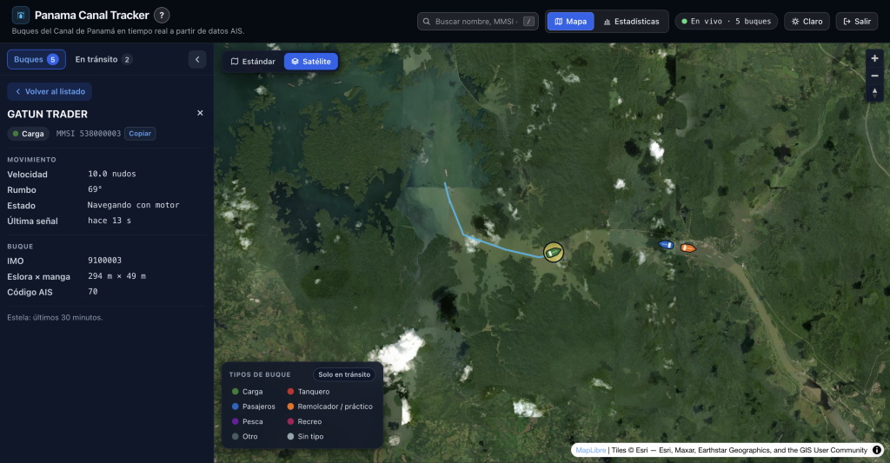 |
| Fleet figures, filters by vessel type and an interactive legend. | Esri World Imagery ([ADR-0018](docs/adr/0018-satelite-esri-world-imagery.md)), dark theme, the last 30 minutes of the trail and times in `America/Panama`. |

| Search and transit progress | Hover tooltip |
| :---: | :---: |
| 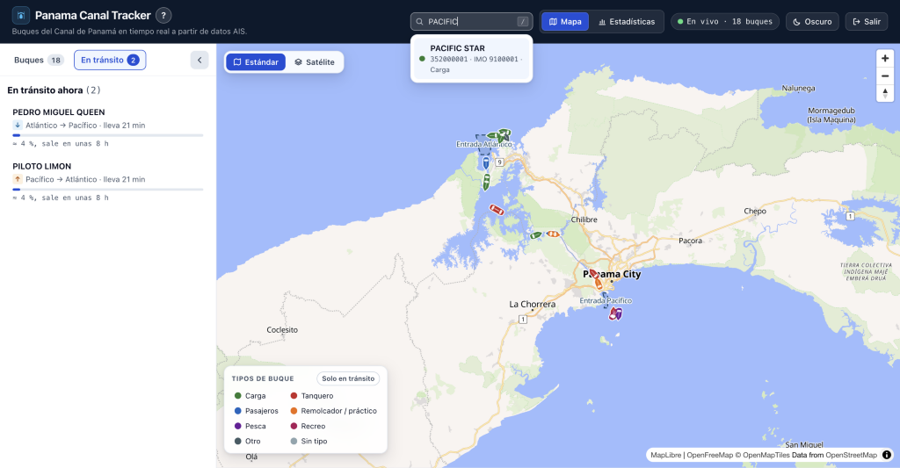 | 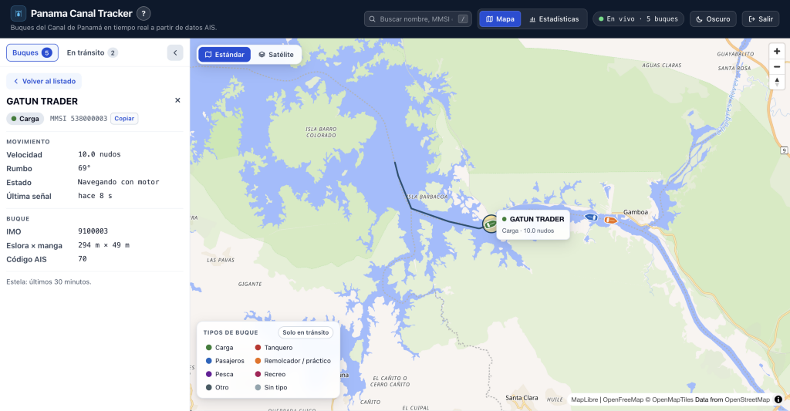 |
| Search by name, MMSI or IMO (`/` or `⌘K`), a shareable URL (`?mmsi=&view=`) and progress estimated against the median transit. | Name, type and speed on hover; signals older than 15 minutes fade. |

| Statistics (`?view=stats`) | Mobile layout (`390×844`) |
| :---: | :---: |
| 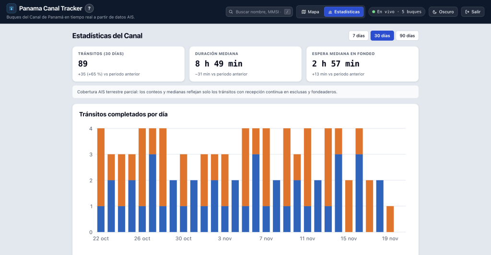 | 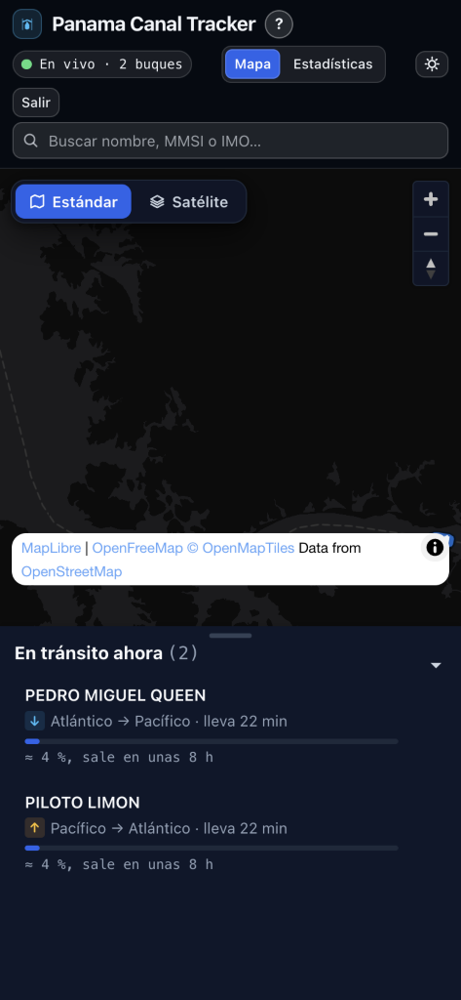 |
| Figures for the period against the previous one, a notice about partial AIS coverage and daily bars by direction. | Compact header and a bottom sheet that can be dragged. |

### History and routes, with simulated data

| History (`?view=history`) | Route window |
| :---: | :---: |
| 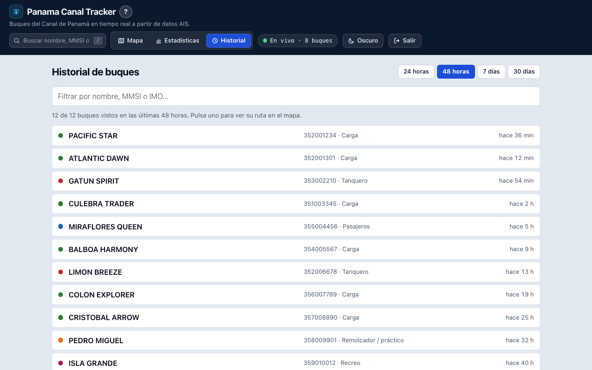 | 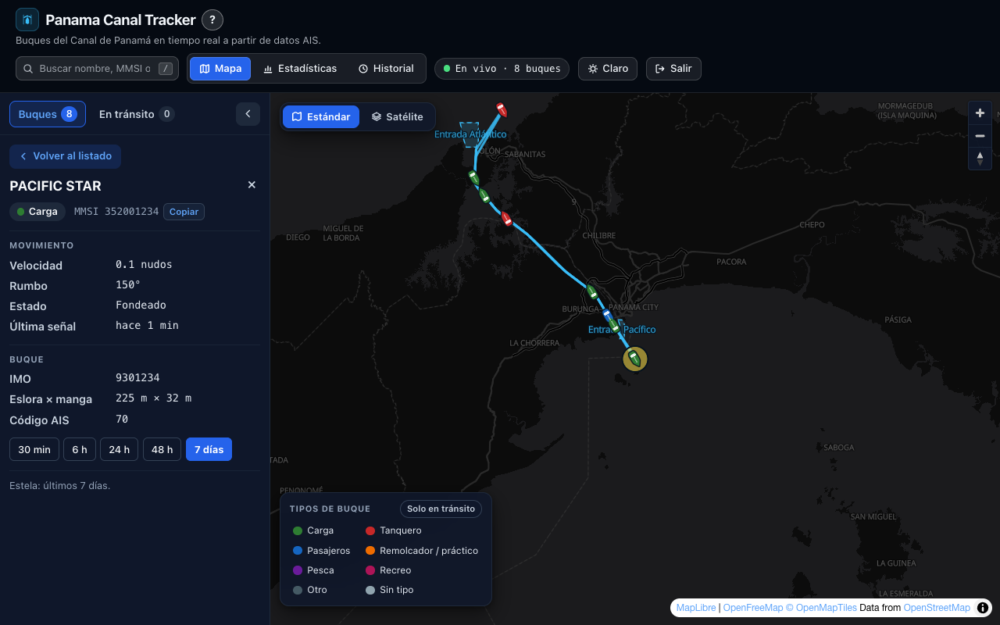 |
| Vessels with a position in the last 24 h, 48 h, 7 or 30 days, newest first, with a filter by name, MMSI or IMO. Choosing one opens it on the map. | The vessel card offers 30 min, 6 h, 24 h, 48 h and 7 days. The line joins only positions that were received and breaks at long gaps in signal. |

The History tab needs the API, so the static demo does not include it. The screenshots above use
simulated vessels with fictitious names.

### With real AIS data

| History, last 48 hours | 7-day route of a cargo ship |
| :---: | :---: |
| 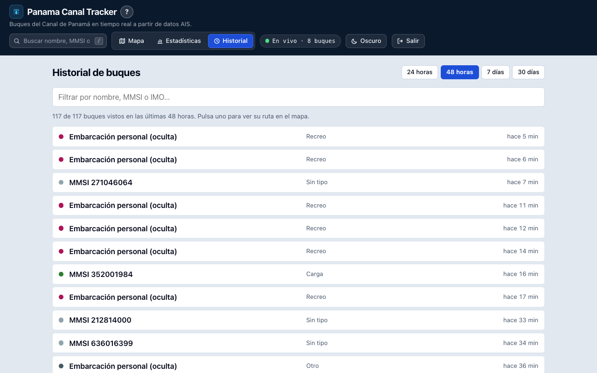 | 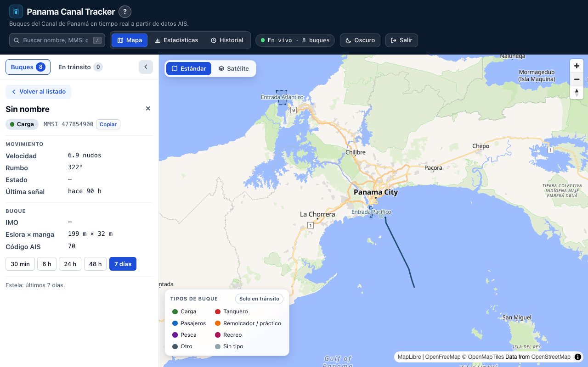 |
| 117 real vessels. Sailing, pleasure and fishing vessels are masked because their name and MMSI can identify a person. | A cargo ship approaching the Pacific anchorage from the south-east. Only commercial vessels are shown with a route. |

Real data from [AISStream.io](https://aisstream.io), collected between 2026-11-07 and 2026-11-22
by the local worker and the GitHub collector. Coverage is partial, so the picture is sparse. These
are static images ([ADR-0020](docs/adr/0020-capturas-con-datos-reales.md)).

### Real-time clips

[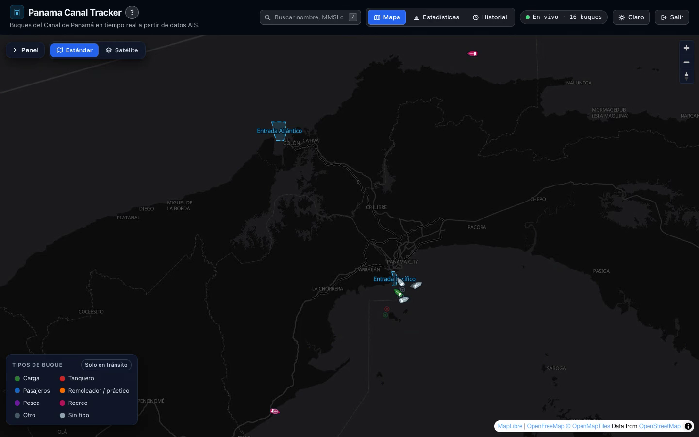](docs/media/real-ais-live-map.mp4)

A 47-second recording of the app running on live AISStream data on 2026-11-24 (click the image to
play it): the map with the Pacific anchorage, the switch between the standard and satellite base
maps, and the card of a cargo ship at anchor with its trail window (30 min, 6 h, 24 h). Coverage
is partial, so no vessel is crossing the Canal in this clip. Hover tooltips and the vessel list are
hidden because they include sailing, pleasure and fishing vessels; only a commercial vessel is
opened. It is a fixed recording, not a live feed
([ADR-0020](docs/adr/0020-capturas-con-datos-reales.md)).

| Time-lapse, 20 minutes at ×20 | A transit starting |
| :---: | :---: |
| [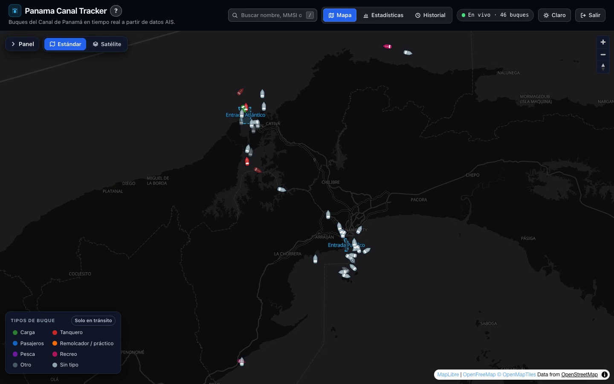](docs/media/real-ais-timelapse.mp4) | [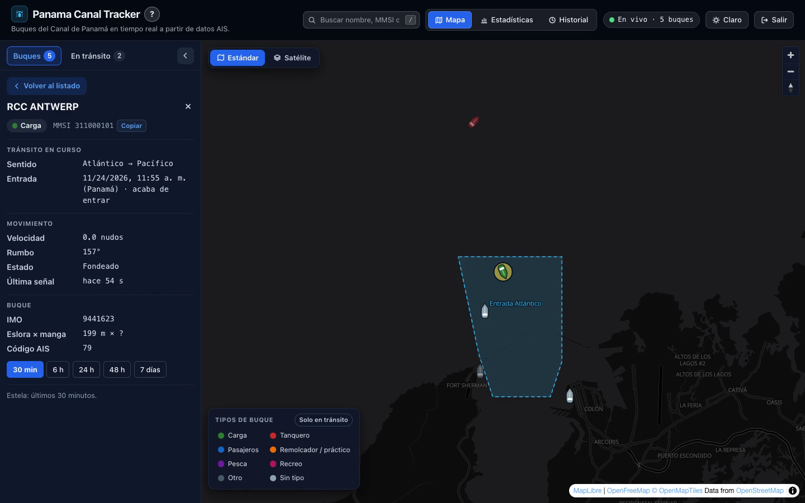](docs/media/real-ais-transit-start.mp4) |
| 20 minutes of the live map sped up 20 times (2026-11-24). The vessels seen go from 16 to 46 as AIS messages arrive. Each vessel reports a position every few minutes, so in real time none is seen moving. | A cargo ship (IMO 9441623) entering the Canal from the Atlantic, with "transit in progress" and the zone entry time. It is still at the entrance and does not advance during the minute recorded. |

Both clips come from the same live data. No vessel completes a crossing in them: of the 37 transits
recorded so far, all ended as `aborted` because the free AIS coverage does not follow vessels along
the whole route.

### Feature clips

Short recordings of the same interface on live AISStream data (2026-11-24); click an image to play
it. Each one is under a minute, has no sound and was recorded with the masking of
[ADR-0020](docs/adr/0020-capturas-con-datos-reales.md) active: the name and MMSI of sailing,
pleasure and fishing vessels are blurred, and only commercial vessels are opened or shown with a
route. Coverage is partial, so the views are sparse.

|  |  |
| :---: | :---: |
| [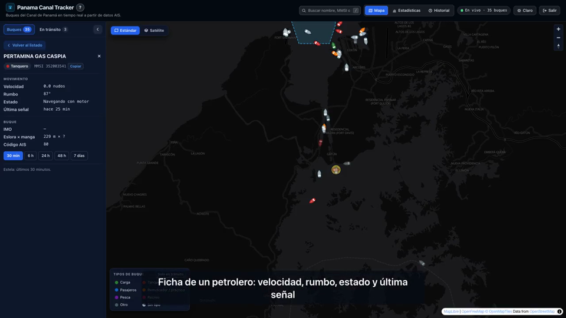](docs/media/real-ais-card-and-trail.mp4)<br>**Card and trail (48 s)**<br>Speed, heading, status and last signal of a tanker, with the trail window switched between 30 min, 6 h, 24 h and 7 days. Gaps in the route are the gaps in AIS reception. | [](docs/media/real-ais-filters-and-search.mp4)<br>**Filters and search (51 s)**<br>Vessel list filtered by type (cargo only, tankers only; non-commercial vessels are blurred), search by name, MMSI or IMO, the card state kept in the URL, and the light and dark themes. |
| [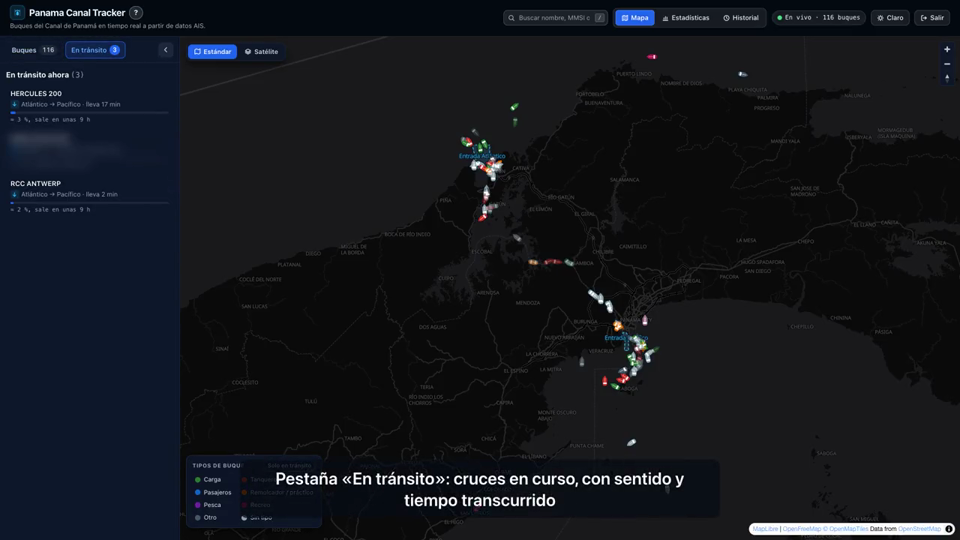](docs/media/real-ais-transits-and-history.mp4)<br>**Transits and history (45 s)**<br>The "in transit" tab, statistics for 7, 30 and 90 days (no completed transits yet with real data) and the history of vessels seen in 24 h, 48 h, 7 or 30 days. | [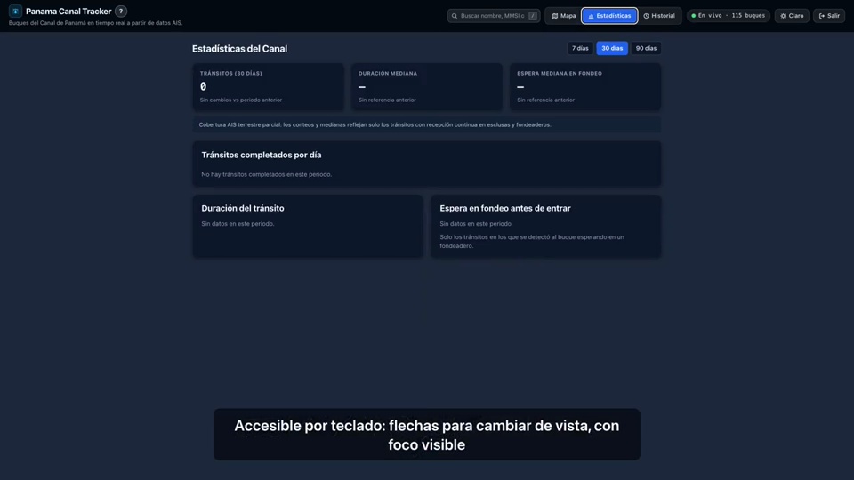](docs/media/real-ais-keyboard.mp4)<br>**Keyboard (33 s)**<br>Arrow keys to switch views with a visible focus, the `/` shortcut to search without the mouse, and focus managed in panels (Escape closes and gives it back). |
| [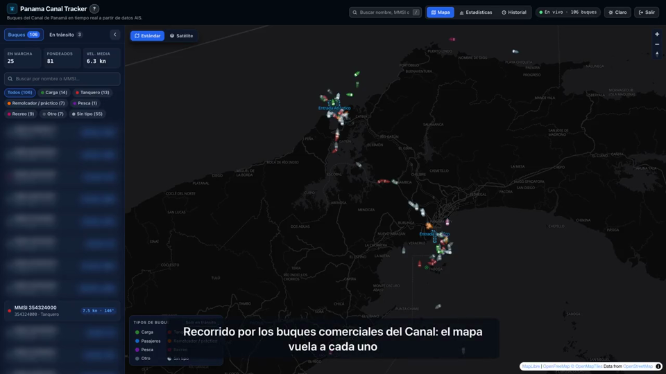](docs/media/real-ais-vessel-tour.mp4)<br>**Vessel tour (60 s)**<br>The map flies from one commercial vessel to the next (tankers and cargo ships), opening each card with position, heading, status and trail. | [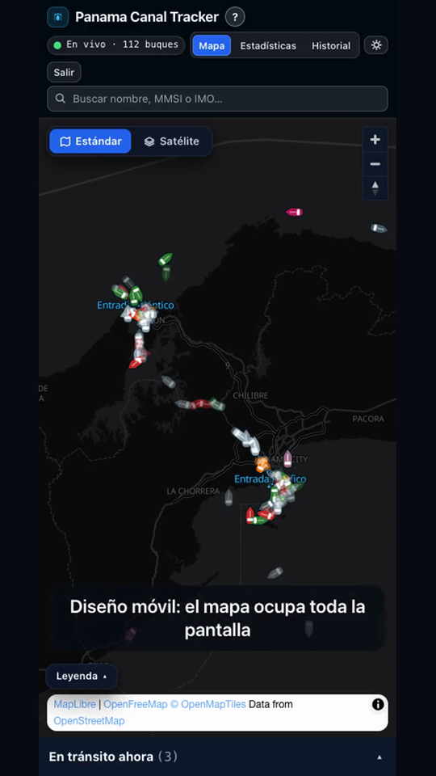](docs/media/real-ais-mobile.mp4)<br>**Mobile (45 s)**<br>Full-screen map, satellite view, the "in transit now" bottom sheet, the vessel card as a sheet you drag, statistics and history. |

The statistics view has no completed transits with real data yet, so this clip uses the simulated
dataset and says so on screen:

[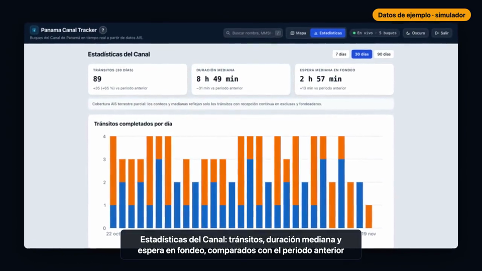](docs/media/demo-stats-simulated.mp4)

## Features

- Ingestion of Class A and Class B AIS messages from AISStream, written in batches every 0.5 s and
  published through Redis to the WebSocket.
- Real-time map with vessels in a single WebGL layer, vector and satellite basemaps, light and dark
  themes, and filtering by vessel type.
- Detection of complete transits between the Atlantic and Pacific entrances, with direction, estimated
  progress and elapsed time ([ADR-0016](docs/adr/0016-sentido-de-entrada-por-rumbo.md)).
- Measurement of waiting time at the Atlantic and Pacific anchorages before entering.
- Statistics by period, and a history view with a selectable route window of up to 7 days.
- Search by name, MMSI or IMO, and state kept in the URL.
- Accessible controls: arrow-key navigation between views, managed focus in panels and visible
  keyboard focus.
- Authentication with short-lived access tokens and rotating refresh tokens in an `HttpOnly`
  cookie, a strict Content Security Policy, and a lint rule that forbids inserting HTML.

## Architecture

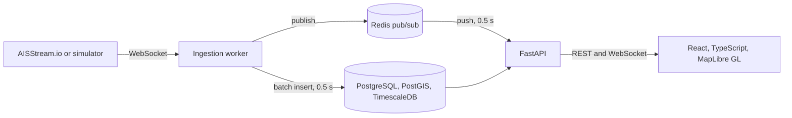

The worker and the API are separate processes ([ADR-0004](docs/adr/0004-worker-separado-y-redis.md)),
so the API can scale without opening more connections to AISStream; the worker is a single
instance by design. Details are in [docs/ARCHITECTURE.md](docs/ARCHITECTURE.md).

## Technology and quality

| Layer | Technology |
|---|---|
| API and authentication | Python 3.12, FastAPI (async), Pydantic v2, PyJWT, `pwdlib` (Argon2id) |
| Data | PostgreSQL 16, PostGIS, TimescaleDB, SQLAlchemy 2.0 async, Alembic |
| Real time | AISStream WebSocket worker, Redis pub/sub, `/ws/live` |
| Frontend | React 19, TypeScript (strict), Vite, MapLibre GL JS, TanStack Query |
| Operations | Docker Compose with non-root, read-only containers, GitHub Actions, Prometheus `/metrics` |

Checks run in CI on every pull request and must pass before merging: 1,147 backend tests
(unit and integration against real PostgreSQL and Redis), 274 frontend tests, `mypy --strict`,
`ruff`, `eslint --max-warnings=0`, `pip-audit`, `npm audit`, `gitleaks`, and a container build.

## Data and limitations

[docs/VALIDATION.md](docs/VALIDATION.md) compares the detector with real AIS over 14.9 days
(2026-11-07 to 2026-11-21):

- The collector listened for 201.4 of 356.4 hours (56.5%) and recorded 10,040 positions from 595
  vessels.
- Only 86 positions (0.9%) fell inside the entrance zones, and 26 inside the Canal corridor.
- The detector completed 2 transits, against roughly 520 expected from the Canal Authority's
  average of about 35 a day.

That gap measures AISStream coverage in Panama, not the accuracy of the detector, and the study
concludes that the data does not allow the thresholds to be calibrated. The transit and anchorage
logic is verified with the simulator and synthetic trajectories. The live map therefore shows few
vessels, and the statistics only count completed transits, so they are mostly empty.

A WebSocket load test with 500 concurrent clients ([docs/LOAD_TEST.md](docs/LOAD_TEST.md)) connected
all of them with no failures and a median snapshot latency of 9 ms (95th percentile 11 ms). Ingestion
kept running under load: 9.5 rows/s against a baseline of 10.6.

## Running it

The full stack (PostgreSQL, Redis, migrations, API, worker and a simulator with 18 vessels) runs in
containers with no external API key:

```bash
cp .env.example .env            # fill in random passwords and JWT_SECRET_KEY; never commit .env
AISSTREAM_URL=ws://simulator:8765 AISSTREAM_API_KEY=simulator \
  docker compose -f docker-compose.stack.yml --profile simulator up -d --build --wait
# API documentation: http://localhost:8000/docs (register, log in, then GET /api/v1/vessels)
docker compose -f docker-compose.stack.yml --profile simulator down   # stop; add -v to wipe data
```

With a real key from AISStream, set `AISSTREAM_API_KEY` in `.env` and leave out the simulator
variables and profile. For development on the host, backups, the macOS worker and loading collected
data, see [docs/OPERATIONS.md](docs/OPERATIONS.md).

## Documentation

[docs/README.md](docs/README.md) is the index. The main documents:

| Document | Content |
|---|---|
| [docs/ARCHITECTURE.md](docs/ARCHITECTURE.md) | Components, data flow, data model and domain logic |
| [docs/API_DESIGN.md](docs/API_DESIGN.md) | REST and WebSocket contract |
| [docs/OPERATIONS.md](docs/OPERATIONS.md) | Running, checking and maintaining the system |
| [docs/VALIDATION.md](docs/VALIDATION.md) | Study with real AIS: what it can and cannot conclude |
| [docs/SECURITY_REVIEW.md](docs/SECURITY_REVIEW.md) | Final security review and what a deployment would need |
| [docs/adr/](docs/adr/README.md) | Architecture decisions ([0001](docs/adr/0001-stack-tecnico.md) to [0020](docs/adr/0020-capturas-con-datos-reales.md)) |
| [docs/ENGINEERING.md](docs/ENGINEERING.md) | Conventions for code, tests, security and workflow |

This README is available in English and Spanish; the rest of the documentation is in Spanish.

## Development process

Each change is one issue, one branch and one pull request, with architecture decisions recorded as
ADRs and a changelog entry per release. History: [issues](https://github.com/zSamir015/panama-canal-tracker/issues),
[merged pull requests](https://github.com/zSamir015/panama-canal-tracker/pulls?q=is%3Apr+is%3Amerged),
[releases](https://github.com/zSamir015/panama-canal-tracker/releases) and the
[changelog](CHANGELOG.md).

## Security

See [SECURITY.md](SECURITY.md) to report a vulnerability and
[docs/SECURITY_REVIEW.md](docs/SECURITY_REVIEW.md) for the review.

## License

All rights reserved. The code is public so that it can be read and evaluated; using, copying or
modifying it requires written permission. See [LICENSE](LICENSE).
