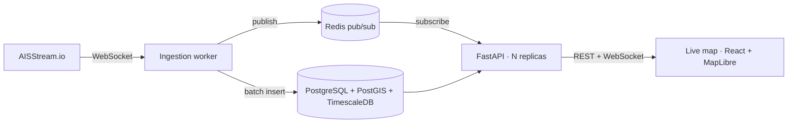

# Panama Canal Tracker

> Real-time tracking of vessels transiting the Panama Canal: live AIS ingestion, automatic
> transit and anchorage-wait detection, and a live map.

[Español](README.es.md)

[](https://github.com/zSamir015/panama-canal-tracker/actions/workflows/ci.yml)
[](LICENSE)

<!-- Demo GIF (Phase 4): docs/media/live-map.gif -->

## What it does

- 📡 **Ingests** live AIS positions over the Canal area from [AISStream.io](https://aisstream.io)
- 🗺️ **Shows** every vessel moving on a real-time map (React + MapLibre GL)
- 🔍 **Detects** complete transits (Atlantic ↔ Pacific) with direction and duration
- ⏱️ **Measures** how long ships wait at anchor before entering the Canal
- 📊 **Exposes** statistics through a documented REST API and a WebSocket stream
- 🔐 **Secures** access with JWT (access + rotating refresh tokens) and roles

There is no public API for official Canal transit data. This project **infers** transits and
waiting times from raw AIS signals, and validates the results against public Panama Canal
Authority statistics.

## Architecture



The ingestion worker and the API are separate processes, so the API scales horizontally while
keeping a single upstream AIS connection. Details in [docs/ARCHITECTURE.md](docs/ARCHITECTURE.md).

## Tech stack

| Layer | Technology |
|---|---|
| API | Python 3.12, FastAPI (async), Pydantic v2 |
| Data | PostgreSQL 16, PostGIS, TimescaleDB, SQLAlchemy 2.0 async, Alembic |
| Real time | AIS WebSocket worker, Redis pub/sub, WebSocket fan-out |
| Frontend | React, TypeScript, Vite, MapLibre GL JS |
| Auth | JWT (PyJWT), Argon2id (pwdlib) |
| Quality | pytest, httpx, ruff, mypy, Vitest |
| Ops | Docker Compose, GitHub Actions, Prometheus metrics |

## Project status

| Phase | Scope | Status |
|---|---|---|
| 0 | Scaffold and documentation | ✅ |
| 1 | FastAPI skeleton, CI, repo security | ✅ |
| 2 | Database and authentication | ✅ |
| 3 | AIS ingestion worker | ⏳ |
| 4 | Real-time map and live demo | ⏳ |
| 5 | Transit detection and validation | ⏳ |
| 6 | Anchorage waits and statistics | ⏳ |
| 7 | Production hardening | ⏳ |

Full plan: [docs/ROADMAP.md](docs/ROADMAP.md).

## Quick start

The whole stack (PostgreSQL, Redis, migrations, API and AIS worker) runs in containers. No
AISStream API key is needed: a simulator replays realistic canal traffic.

```bash
cp .env.example .env            # fill in random passwords and JWT_SECRET_KEY; never commit .env
AISSTREAM_URL=ws://simulator:8765 AISSTREAM_API_KEY=simulator \
  docker compose -f docker-compose.stack.yml --profile simulator up -d --build --wait
# API docs: http://localhost:8000/docs (register, log in, then GET /api/v1/vessels)
docker compose -f docker-compose.stack.yml --profile simulator down   # stop (add -v to wipe data)
```

With a real key, set `AISSTREAM_API_KEY` in `.env` and drop the simulator variables and profile.
For development (API on the host with `--reload`), see [AGENTS.md](AGENTS.md#10-comandos-útiles).

## Documentation

| Document | Content |
|---|---|
| [docs/ARCHITECTURE.md](docs/ARCHITECTURE.md) | Components, data flow, data model |
| [docs/ROADMAP.md](docs/ROADMAP.md) | Phases with acceptance criteria |
| [docs/API_DESIGN.md](docs/API_DESIGN.md) | REST and WebSocket contract |
| [docs/DATA_SOURCES.md](docs/DATA_SOURCES.md) | AIS source, limits, geographic zones |
| [docs/adr/](docs/adr/) | Architecture decision records |
| [AGENTS.md](AGENTS.md) | Engineering and security conventions for this repository |
| [SECURITY.md](SECURITY.md) | How to report a vulnerability |

## License

[MIT](LICENSE)
