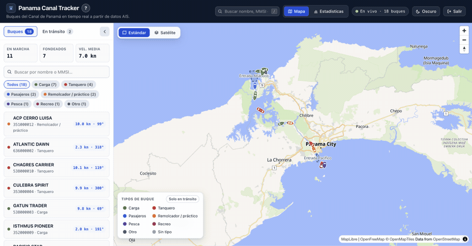
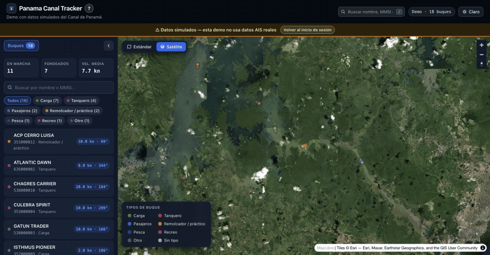
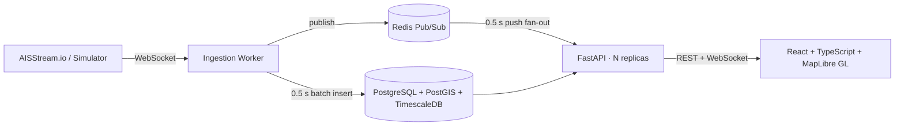

# Panama Canal Tracker

> Real-time vessel tracking across the Panama Canal: live Class A/B AIS ingestion, automatic
> transit and anchorage-wait detection, interactive satellite/vector mapping, and canal analytics.

[Español](README.es.md)

[](https://github.com/zSamir015/panama-canal-tracker/actions/workflows/ci.yml)
[](LICENSE)

**[Live demo](https://zsamir015.github.io/panama-canal-tracker/)** — runs directly in the browser on
OSM-aligned simulated trajectories (or via **Ver demo sin cuenta** on the login screen, no API key
required).



---

## Visual Tour & Key Capabilities

### Real-Time Canal Navigation (Dark OLED + Esri Satellite)
All simulated and live vessel routes follow the real navigable OpenStreetMap fairway through Limón
Bay, Gatun Locks, Gatun Lake, Culebra Cut, and Balboa without land crossings. Top-down directional
naval hulls pair with compact anchorage beacons and zoom-scaled sizing.



### Feature Gallery

| Desktop Light & Operational Sidebar | Dark OLED & Satellite Layer |
| :---: | :---: |
|  |  |
| *18-vessel operational fleet, live fleet KPIs, category filter pills, and interactive map legend* | *Esri World Imagery (`ADR-0018`), OLED dark chrome, 30-min wake trail, `Copiar MMSI`, and `America/Panama` timestamps* |

| Global Search (`/`, `⌘K`) & Transit Progress | Desktop Hover Tooltip & Zoom Scaling |
| :---: | :---: |
|  |  |
| *Fuzzy header combobox (`name`, `MMSI`, `IMO`), shareable URL state (`?mmsi=&view=`), and median-based transit progress* | *Pointer tooltip (`name · category · SOG`), stale-signal attenuation (>15 min), and zoom-aware anchorage sizing* |

| Canal Statistics (`?view=stats`) | Mobile (`390×844`) Gesture Bottom Sheet |
| :---: | :---: |
|  |  |
| *Period KPI strip with prior-window deltas, honest terrestrial AIS coverage disclosure, and filterable daily bars* | *`100dvh` iOS Safari layout fix, compact 2-row header, and pointer-draggable mobile sheet* |

---

## What It Does

- 📡 **Ingests** live Class A & Class B AIS streams (`PositionReport`, `StandardClassBPositionReport`,
  `ExtendedClassBPositionReport`, `StaticDataReport`, `ShipStaticData`) from
  [AISStream.io](https://aisstream.io) with `0.5 s` batch flush and WebSocket fan-out
- 🗺️ **Renders** vessels in a single WebGL GeoJSON layer (React + MapLibre GL) with directional naval
  hull silhouettes, `Estándar / Satélite` basemaps, Light/Dark OLED themes (`prefers-color-scheme`),
  and stale-signal attenuation
- 🔍 **Detects** complete transits (Atlantic ↔ Pacific) with direction, estimated progress bar,
  elapsed duration, and historic medians
- ⏱️ **Measures** anchorage wait times before canal entry across Atlantic and Pacific zones
- 📊 **Exposes** REST analytics and live WebSocket telemetry backed by TimescaleDB + PostGIS
- ♿ **Engineered UX & A11y**: WAI-ARIA `tablist`/`tab` arrow navigation, automatic panel focus
  transfer/restoration, `/` & `⌘K` vessel search, URL deep-linking, password visibility toggle,
  friendly Spanish retryable errors, and tabular monospace telemetry (`--font-mono`)
- 🔐 **Hardened Security**: JWT access + rotating HttpOnly refresh tokens (`Argon2id`), strict CSP,
  and CI ESLint checks enforcing zero `dangerouslySetInnerHTML`

There is no public API for official Canal transit data. This project **infers** transits and
waiting times from raw AIS signals and transparently surfaces terrestrial AIS coverage limits in
both empty states and analytics.

## Architecture



The ingestion worker and API run as decoupled processes so the API scales horizontally while
keeping a single upstream AIS connection. Full details in [docs/ARCHITECTURE.md](docs/ARCHITECTURE.md).

## Tech Stack & Quality Bar

| Layer | Technology & Verification |
|---|---|
| API & Auth | Python 3.12, FastAPI (async), Pydantic v2, PyJWT, `pwdlib` (Argon2id) |
| Data & Geo | PostgreSQL 16, PostGIS, TimescaleDB, SQLAlchemy 2.0 async, Alembic |
| Real Time | AIS Class A/B WebSocket worker (`0.5 s`), Redis pub/sub, `/ws/live` fan-out |
| Frontend | React 19, TypeScript (strict), Vite, MapLibre GL JS (WebGL), TanStack Query |
| Quality | **797** backend unit tests (`pytest -m "not integration"`), **247** frontend tests (`Vitest`), `mypy --strict`, `ruff`, `eslint --max-warnings=0`, `pip-audit`, `gitleaks` |
| Ops | Docker Compose (non-root hardened containers), GitHub Actions (7 CI checks), Prometheus `/metrics` |

## Project Status

| Phase | Scope | Status |
|---|---|---|
| 0 | Scaffold and documentation | ✅ |
| 1 | FastAPI skeleton, CI, repo security | ✅ |
| 2 | Database and authentication | ✅ |
| 3 | AIS ingestion worker | ✅ |
| 4 | Real-time map and live demo | ✅ |
| 5 | Transit detection and validation | ✅ |
| 6 | Anchorage waits and statistics | ✅ |
| 7 | Production hardening & UI/UX overhaul | ✅ (`v1.0.0` released; no managed prod deploy per [ADR-0017](docs/adr/0017-v1-sin-entorno-de-produccion.md)) |

Phases 0–7 are complete; `v1.0.0` is released.

## Validation & Load Test Results

- **Real AIS Validation ([docs/VALIDATION.md](docs/VALIDATION.md))**: across **12.5 days** (`2026-11-07`
  to `2026-11-19`, `29` collector runs covering `156.3 h / 299.4 h` or `52.2%`), the tracker
  recorded **8,286 positions** from **500 vessels**, **304 anchorage visits** (`267` Pacific, `37`
  Atlantic), and **2 full transits** (`18 h 48 min` and `10 h 08 min` southbound) vs `~437` expected
  (`~35/day` ACP average). Only `84` positions (`1.0%`) fell in entrance zones and `25` inside Culebra
  / Miraflores, confirming free terrestrial AISStream coverage inside the Canal is partial while
  `2,578` stopped positions fall outside the initial anchorage boxes. Transit thresholds remain
  calibrated on OSM-aligned synthetic tracks, while `ADR-0019` and `scripts/ais_coverage.py`
  (`#165`, `#169`) improve collection uptime and measure Type 27 / wide-bbox reception.
- **WebSocket `/ws/live` Load Test ([docs/LOAD_TEST.md](docs/LOAD_TEST.md))**: with **500 concurrent
  WebSocket clients** against FastAPI + Redis + TimescaleDB (Apple M5 10-core, simulator `--speed 60`),
  all **500/500** connected and received an initial snapshot with **0 failures** (`9 ms` p50 /
  `11 ms` p95 / `37 ms` max latency), `17,466` pushed updates (`2.00 s` p50 interval), **7.8% avg /
  10.9% max** API CPU, **153 MB** peak API memory, and no ingestion degradation (`10.63 rows/s`
  baseline vs `9.52 rows/s` under load).

## How It Was Built

Built strictly phase-by-phase (`un issue = una rama = un PR`) with architecture decisions locked in ADRs:

- **Roadmap & Milestones**: [docs/ROADMAP.md](docs/ROADMAP.md) (Phases `0`–`7`, acceptance criteria)
- **Key Technical Decisions (`docs/adr/`)**: separated AIS worker + Redis pub/sub (`ADR-0004`),
  TimescaleDB hypertables + PostGIS (`ADR-0005`), WebGL GeoJSON rendering (`ADR-0006`), Argon2id +
  PyJWT (`ADR-0003`), static GitHub Pages demo (`ADR-0011`), SQL/TimescaleDB stats (`ADR-0013`),
  GPG encrypted DB backups (`ADR-0015`), Esri World Imagery (`ADR-0018`), and continuous collector
  chaining with macOS `launchd` worker within the 2-socket limit (`ADR-0012`, `ADR-0019`). Full index:
  [0001](docs/adr/0001-stack-tecnico.md)–[0019](docs/adr/0019-recolector-continuo-y-worker-a-la-vez.md).
- **Security Baseline**: [docs/SECURITY_REVIEW.md](docs/SECURITY_REVIEW.md) & [SECURITY.md](SECURITY.md)
- **GitHub History**: [Issues](https://github.com/zSamir015/panama-canal-tracker/issues) ·
  [Merged PRs](https://github.com/zSamir015/panama-canal-tracker/pulls?q=is%3Apr+is%3Amerged) ·
  [Releases (`v0.1.0`–`v0.6.0`)](https://github.com/zSamir015/panama-canal-tracker/releases) ·
  [CHANGELOG.md](CHANGELOG.md)

## Quick Start

The whole stack (PostgreSQL, Redis, migrations, API, AIS worker, and 18-vessel simulator at `2×`
speed) runs in containers without any external API key:

```bash
cp .env.example .env            # fill in random passwords and JWT_SECRET_KEY; never commit .env
AISSTREAM_URL=ws://simulator:8765 AISSTREAM_API_KEY=simulator \
  docker compose -f docker-compose.stack.yml --profile simulator up -d --build --wait
# API docs: http://localhost:8000/docs (register, log in, then GET /api/v1/vessels)
docker compose -f docker-compose.stack.yml --profile simulator down   # stop (add -v to wipe data)
```

With a live key from AISStream.io, set `AISSTREAM_API_KEY` in `.env` and omit the simulator env vars
and profile. For local host development (`--reload`), see [AGENTS.md](AGENTS.md#10-comandos-útiles).

## Documentation

| Document | Content |
|---|---|
| [docs/ARCHITECTURE.md](docs/ARCHITECTURE.md) | Components, data flow, data model |
| [docs/ROADMAP.md](docs/ROADMAP.md) | Phases with acceptance criteria |
| [docs/API_DESIGN.md](docs/API_DESIGN.md) | REST and WebSocket contract |
| [docs/DATA_SOURCES.md](docs/DATA_SOURCES.md) | AIS source, limits, geographic zones |
| [docs/LOAD_TEST.md](docs/LOAD_TEST.md) | WebSocket load test: 500 clients, results and method |
| [docs/VALIDATION.md](docs/VALIDATION.md) | 12.5-day real AIS coverage study & precision findings |
| [docs/SECURITY_REVIEW.md](docs/SECURITY_REVIEW.md) | Security checklist & production hardening baseline |
| [docs/AIS_COLLECTOR.md](docs/AIS_COLLECTOR.md) | Continuous GitHub Actions AIS collector workflow |
| [docs/LOCAL_WORKER_MAC.md](docs/LOCAL_WORKER_MAC.md) | Stable macOS local worker setup (`launchd` + `caffeinate`) |
| [docs/adr/](docs/adr/) | Architecture Decision Records ([0001](docs/adr/0001-stack-tecnico.md)–[0019](docs/adr/0019-recolector-continuo-y-worker-a-la-vez.md)) |
| [AGENTS.md](AGENTS.md) | Engineering and security conventions for this repository |
| [SECURITY.md](SECURITY.md) | How to report a vulnerability |

## License

All rights reserved. The code is public so it can be viewed and evaluated; using, copying or modifying it requires written permission. See [LICENSE](LICENSE).
