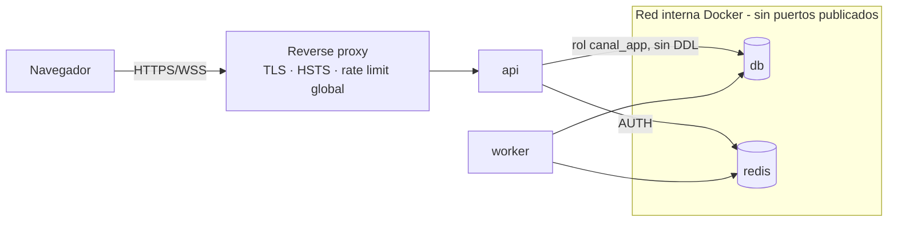

# Arquitectura — Panama Canal Tracker

## 1. Vista general

```
   AISStream.io (WebSocket, 1 conexión por API key)
              │
              ▼
┌─────────────────────────┐        ┌──────────────────────────────────────┐
│  worker (proceso propio) │        │  PostgreSQL 16 + PostGIS + TimescaleDB│
│  app/workers/            │──────▶│  vessels · positions (hypertable)     │
│  · parseo + validación   │ batch  │  transits · anchorage_visits · users  │
│  · batch insert          │ insert └──────────────────────────────────────┘
│  · detección de tránsitos│                     ▲
│  · publica en Redis      │                     │ lecturas
└────────────┬────────────┘                     │
             │ PUBLISH canal:vessels.live        │
             ▼                                   │
        ┌─────────┐   SUBSCRIBE   ┌──────────────┴───────────┐
        │  Redis  │──────────────▶│  api (N réplicas)         │
        └─────────┘               │  FastAPI · REST /api/v1   │
                                  │  WS /ws/live (fan-out)    │
                                  └──────────────┬───────────┘
                                                 │ HTTPS + WSS
                                                 ▼
                                  ┌──────────────────────────┐
                                  │  web/ (React + MapLibre)  │
                                  │  mapa en tiempo real      │
                                  └──────────────────────────┘
```

**Principio rector**: la ingesta y la API son procesos distintos (ADR-0004). La API se puede
escalar horizontalmente sin abrir más conexiones a AISStream; el worker es único por diseño.

## 2. Componentes

### 2.1 Worker de ingesta (`app/workers/ais_consumer.py`)
- Proceso independiente: `python -m app.workers.ais_consumer`. **Una sola réplica.**
- Única conexión a `wss://stream.aisstream.io/v0/stream`, suscrita por bounding box.
- Mensajes: `PositionReport` y `ShipStaticData`.
- Suscripción enviada al abrir la conexión (AISStream cierra si no llega en 3 s); se espera la
  `SubscriptionConfirmation`. La API key solo viaja en ese mensaje y nunca se registra (el logger
  de la librería `websockets` está fijado en INFO porque en DEBUG escribe los frames).
- Reconexión con backoff exponencial con jitter (1 s → máx. `AIS_RECONNECT_MAX_SECONDS`, 60 s);
  el backoff vuelve a 1 s tras una conexión que confirmó la suscripción. Cada caída se loguea.
- Pipeline interno:
  1. **Parser** (`app/services/ais_parser.py`, puro, sin I/O) al leer cada frame: JSON AIS →
     objetos de dominio validados. Los rechazos se cuentan por motivo, no se encolan.
  2. **Cola acotada** (`asyncio.Queue`, `AIS_QUEUE_MAX_SIZE`): la lectura del WebSocket nunca
     espera; si el writer no da abasto, se descartan los mensajes más antiguos y se cuentan.
  3. **Writer** (`app/workers/ais_writer.py`): lotes de `AIS_BATCH_SIZE` registros o cada
     `AIS_BATCH_FLUSH_SECONDS`, en una transacción: upsert de `vessels` (un `NULL` no borra un
     dato conocido; `last_seen_at` solo avanza) y después `positions` con `ON CONFLICT DO
     NOTHING`. Si la base rechaza un dato, se reintenta fila a fila con savepoints y solo se
     descarta la fila mala; si la base no responde, se reintenta el lote con backoff y, al final,
     se descarta contándolo. Al parar, vacía la cola antes de salir.
  4. **TransitDetector** (desde Fase 5): máquina de estados por buque.
  5. **Publisher** (`app/workers/ais_publisher.py`): tras el commit de cada lote, un `PUBLISH` en
     `canal:vessels.live` con la última posición de cada buque del lote, con el formato de
     `/ws/live` (`{"type": "update", "vessels": [...]}`, como mucho 200 buques por mensaje) y
     validado con Pydantic. Si Redis no responde (timeout de 1 s, sin reintentos), se cuenta el
     fallo, se deja de intentar 5 s y la ingesta sigue: la base es la fuente de verdad.
- Expone su estado en `canal:ais:worker:status` (cada 5 s, con `updated_at` y caducidad de 15 s):
  conexión, último mensaje, reconexiones, cola, rechazos por motivo y contadores del writer, para
  `/admin/ingestion/status` (3.9). Si el worker muere, la clave caduca sola.

### 2.2 API (`app/main.py`, `app/routers/`)
- FastAPI async, sin estado: cualquier réplica atiende cualquier request.
- REST bajo `/api/v1`; `/health` y `/ready` fuera del prefijo (para el orquestador).
- Contrato completo en `API_DESIGN.md`.

### 2.3 WebSocket `/ws/live`
- Cada réplica se suscribe a `canal:vessels.live` en Redis y reenvía a sus clientes conectados.
- **Escalable por diseño**:
  - El cliente envía su **viewport** (bbox del mapa) y solo recibe buques dentro de él.
  - Las actualizaciones se **agrupan** y se envían como máximo 1 vez por segundo por cliente.
  - Al conectar, el cliente recibe un **snapshot** (última posición de cada buque) y luego deltas.
  - Backpressure: si un cliente no consume, se descartan sus mensajes viejos, nunca se bloquea
    al resto.

### 2.4 Mapa web (`web/`)
- React + TypeScript + Vite + MapLibre GL JS (ADR-0006).
- Buques como **una capa GeoJSON** renderizada por WebGL (escala a miles de puntos), icono rotado
  según rumbo (COG/heading) y color por tipo de buque.
- Funciones: posiciones en vivo, ficha del buque al hacer clic, estela de los últimos N minutos,
  zonas del Canal y fondeaderos dibujadas, panel de tránsitos en curso.

### 2.5 Servicios de dominio (`app/services/`)
- `TransitService`: detección de tránsitos (ver §4).
- `AnchorageService`: detección de esperas en fondeo (ver §4).
- `StatsService`: estadísticas sobre agregados continuos de TimescaleDB.

## 3. Modelo de datos (propuesta — se refina en cada fase con migraciones Alembic)

### `vessels`
| Campo | Tipo | Notas |
|---|---|---|
| mmsi | INTEGER PK | 9 dígitos |
| imo | INTEGER NULL | de `ShipStaticData` |
| name | VARCHAR | |
| ship_type | SMALLINT | código AIS |
| length_m / beam_m | REAL | derivados de dimensiones A+B / C+D |
| last_seen_at | TIMESTAMPTZ | índice |
| updated_at | TIMESTAMPTZ | |

### `positions` (hypertable TimescaleDB, ADR-0005)
| Campo | Tipo | Notas |
|---|---|---|
| received_at | TIMESTAMPTZ | dimensión de tiempo de la hypertable |
| vessel_mmsi | INTEGER | índice compuesto (`vessel_mmsi`, `received_at DESC`) |
| geom | GEOGRAPHY(POINT, 4326) | índice GIST |
| sog / cog / heading | REAL | velocidad, rumbo, proa |
| nav_status | SMALLINT | estado de navegación AIS (fondeado, en ruta...) |

- FK hacia `vessels.mmsi`; el writer hace upsert del buque antes de insertar posiciones, en la
  misma transacción, para evitar posiciones huérfanas.
- **Compresión** de chunks > 7 días; **política de downsampling** para datos > 90 días
  (agregado continuo con una posición cada 5 min). El histórico no se borra, se compacta.

### `transits`
| Campo | Tipo | Notas |
|---|---|---|
| id | UUID PK | |
| vessel_mmsi | FK → vessels | |
| direction | ENUM | `northbound` (Pacífico → Atlántico) / `southbound` (Atlántico → Pacífico) |
| status | ENUM | `in_progress` / `completed` / `aborted` |
| entered_at / exited_at | TIMESTAMPTZ | |
| duration_minutes | INTEGER GENERATED | `exited_at - entered_at` |
| lock_route | ENUM NULL | `panamax` / `neopanamax` si se puede inferir (idea, no obligatoria) |

### `anchorage_visits`
| Campo | Tipo | Notas |
|---|---|---|
| id | UUID PK | |
| vessel_mmsi | FK → vessels | |
| anchorage | ENUM | `atlantic` / `pacific` |
| arrived_at / departed_at | TIMESTAMPTZ | |
| transit_id | FK → transits NULL | se enlaza cuando el buque entra al Canal |

### `users`
| Campo | Tipo | Notas |
|---|---|---|
| id | UUID PK | |
| email | VARCHAR UNIQUE | |
| hashed_password | VARCHAR | Argon2id (nunca se devuelve ni se loguea) |
| role | ENUM | `user` / `admin` |
| created_at | TIMESTAMPTZ | |

### `refresh_tokens`
| Campo | Tipo | Notas |
|---|---|---|
| jti | UUID PK | id del token |
| family_id | UUID | sesión; si se reusa un token rotado se revoca la familia completa |
| user_id | FK → users | |
| expires_at | TIMESTAMPTZ | |
| revoked_at | TIMESTAMPTZ NULL | permite logout y rotación segura |

## 4. Lógica de dominio

### 4.1 Zonas (constantes GeoJSON en `app/services/zones.py`)
- `ATLANTIC_ENTRANCE`: entrada del Canal por el Atlántico (área de Limón Bay / Cristóbal).
- `PACIFIC_ENTRANCE`: entrada por el Pacífico (área de Balboa / Puente de las Américas).
- `ATLANTIC_ANCHORAGE` y `PACIFIC_ANCHORAGE`: fondeaderos donde los buques esperan turno.
- Los polígonos se dibujan en la Fase 5 con datos reales y se versionan en el repo.

### 4.2 Detección de tránsitos (máquina de estados por buque)
- Entra a una zona de entrada → `transit` `in_progress`.
- Aparece en la zona de entrada opuesta → `completed`, con dirección y duración.
- Sin señal más de `TRANSIT_SIGNAL_TIMEOUT_MINUTES` → `aborted`.
- Vuelve a la misma entrada → `aborted` (reversa).
- La lógica es pura (sin I/O) para testearla con trayectorias sintéticas.

### 4.3 Tiempo de espera
- `nav_status = anclado` o SOG < 0,5 nudos durante > 15 min dentro de un fondeadero → visita.
- Tiempo de espera = desde `arrived_at` hasta `entered_at` del tránsito siguiente del buque.

## 5. Despliegue

- `docker compose` con 4 servicios: `db` (TimescaleDB + PostGIS), `redis`, `api`, `worker`.
  El frontend se sirve como estático (CDN o el mismo host).
- Imágenes multi-stage, usuario no root, healthchecks.
- Producción: un VPS pequeño basta para el volumen del Canal; la arquitectura permite separar
  servicios si crece. El worker necesita estar **siempre encendido** (los planes que duermen
  procesos no sirven).

## 6. Seguridad (resumen; reglas completas en AGENTS.md §8)



- Solo el reverse proxy publica puertos (80/443). DB y Redis viven en la red interna.
- Contenedores (`Dockerfile`, `docker-compose.stack.yml`): imágenes `api` y `worker` desde una
  base fijada por digest, dependencias solo de `requirements.lock` con hashes, usuario sin
  privilegios (uid 10001), sistema de archivos de solo lectura, sin capabilities. Cada servicio
  recibe solo sus variables: la key de AISStream solo el worker; el rol `canal_owner` solo el
  servicio `migrate`, que aplica las migraciones y termina antes de que arranquen API y worker.
- La API no conoce la key de AISStream; solo el worker la tiene.
- Migraciones con el rol `canal_owner`; la app corre con `canal_app` (sin DDL).
- Autorización denegada por defecto y verificada por un test que recorre todas las rutas.

## 7. Observabilidad

- Logs JSON con `structlog` (id de request, MMSI cuando aplique).
- `GET /metrics` (Prometheus): mensajes AIS/s, reconexiones, latencia de inserción, clientes WS.
- `/health` (proceso vivo) y `/ready` (DB y Redis alcanzables).

## 8. Riesgos conocidos

1. **Cobertura AIS terrestre**: buques a más de ~40 NM de la costa no aparecen. Para el Canal basta.
2. **Sin histórico en la fuente**: nuestra DB es el histórico; cada minuto de worker caído son
   datos perdidos. Mitigación: reinicio automático, alertas por silencio prolongado.
3. **Volumen**: cientos de mensajes por minuto. Mitigación: batch inserts, hypertable,
   compresión.
4. **Calidad AIS**: posiciones erróneas, MMSI duplicados o falsos. Mitigación: validación en el
   parser y filtros de saltos imposibles (velocidad implícita > 50 nudos).
5. **AIS como vector de ataque**: cualquiera puede emitir AIS con texto arbitrario (nombres con
   HTML o scripts). Mitigación: validación y longitud máxima en el parser; el frontend nunca
   renderiza esos campos como HTML (AGENTS.md §8.7).
6. **Términos de AISStream**: verificar si permiten mostrar datos en una demo pública (Fase 3.7).

## 9. Decisiones

Ver `docs/adr/`: 0001 stack · 0002 AISStream · 0003 auth · 0004 worker + Redis ·
0005 TimescaleDB · 0006 mapa web.
