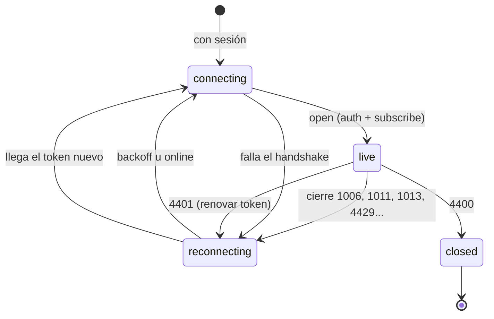

# web/ — Mapa en tiempo real

Frontend del proyecto (Fase 4 del roadmap, ADR-0006): React + TypeScript (`strict`) + Vite.
Pide iniciar sesión (ADR-0008), abre `/ws/live` y pinta los buques del viewport en un mapa
MapLibre GL como una capa GeoJSON: flecha girada según el rumbo, color según el tipo de buque.

## Requisitos

Node `^22.22.2`, `^24.15.0` o `>=26` (lo que admiten Vite, Vitest y jsdom; ver `engines` en
`package.json`).

## Comandos

```bash
cd web
npm ci                 # instala exactamente lo de package-lock.json
npm run dev            # servidor de desarrollo en http://localhost:5173 (proxy de /api y /ws a :8000)
npm run lint           # ESLint con reglas que usan los tipos; 0 avisos permitidos
npm run format:check   # Prettier (npm run format para corregir)
npm run typecheck      # tsc en modo estricto
npm test               # Vitest + Testing Library (jsdom)
npm run build          # comprobación de tipos + build de producción en dist/ (sin source maps)
npm audit              # vulnerabilidades conocidas en las dependencias
```

El job `Frontend (web)` del CI (`.github/workflows/ci.yml`) corre estos mismos pasos en cada PR,
en este orden: `npm ci`, `format:check`, `lint`, `typecheck`, `test`, `build` y `npm audit`.

## Configuración

Variables `VITE_*` en `web/.env` (ver la sección "Frontend" de `.env.example` en la raíz). **Todo
lo que lleva `VITE_` termina en el JavaScript público**: nunca secretos. `src/config.ts` las lee y
rechaza URLs que no sean `http(s)` o que lleven credenciales.

| Variable             | Para qué                                                             |
| -------------------- | -------------------------------------------------------------------- |
| `VITE_API_URL`       | Origen de la API; vacío = el mismo del frontend (detrás del proxy)   |
| `VITE_MAP_STYLE_URL` | Estilo de tiles de MapLibre; vacío = OpenFreeMap, sin key (ADR-0010) |

## Ver el mapa en local

Con la base, Redis, la API (`uvicorn app.main:app`), el simulador y el worker en marcha (ver
`AGENTS.md` §10), `npm run dev` y abrir `http://localhost:5173`. El proxy de Vite deja la API en
el mismo origen, así que `CORS_ORIGINS` solo necesita `http://localhost:5173`. Hace falta una
cuenta (`POST /api/v1/auth/register` o `/docs`).

## Cómo está organizado

| Carpeta        | Qué hay                                                                               |
| -------------- | ------------------------------------------------------------------------------------- |
| `src/auth/`    | Login y sesión (`useSession`); el access token vive solo en memoria (AGENTS.md §8.4)  |
| `src/live/`    | Protocolo de `/ws/live`, estado de los buques y el hook `useLiveVessels`              |
| `src/api/`     | Cliente REST de `/api/v1` con el token en la cabecera (`ApiError` con el código HTTP) |
| `src/vessels/` | Ficha del buque (`VesselPanel`), estela de 30 min, consultas con TanStack Query       |
| `src/map/`     | `VesselMap` (MapLibre), GeoJSON, categorías y colores, iconos SDF y viewport          |

Al hacer clic en un buque se abre su ficha y se dibuja su estela (`GET /vessels/{mmsi}/history`,
recargada cada 15 s). La estela se corta donde faltan más de 5 minutos de señal, para no inventar
un trayecto. Escape o un clic en el mar cierran la ficha.

### Sesión y reconexión

- **Sesión** (`useSession`): el access token sigue solo en memoria. Al cargar la página se
  recupera con la cookie del refresh (`POST /auth/refresh`), así que recargar no pide entrar. Se
  renueva un minuto antes de caducar y también si la API lo rechaza (401 o cierre `4401`). Cada
  refresh rota la cookie y reutilizar una ya rotada revoca la sesión, así que nunca hay dos
  renovaciones a la vez: dentro de la pestaña comparten la petición y, entre pestañas, un Web Lock
  las pone en fila. Si la renovación falla por red, se conserva el token y se reintenta cada 10 s;
  solo un 401 del refresh devuelve al login ("La sesión caducó").
- **WebSocket** (`useLiveVessels`): si la conexión se cae, reconecta con backoff exponencial con
  jitter (1 s → 30 s; al menos 15 s tras `4429`) o en cuanto vuelve la red, y se suscribe otra vez
  al viewport. Los buques se quedan pintados hasta el snapshot nuevo. Un token renovado no reabre
  la conexión (el servidor solo lo mira en el `auth`). Con `4401` pide renovar y reconecta con el
  token nuevo; con `4400` (mensaje inválido, error del cliente) no reintenta.
- **Indicador** en la cabecera: "Conectando…", "En vivo", "Reconectando…" o "Desconectado".



## Seguridad

- Los datos de buques vienen de AIS y cualquiera puede escribirlos: se muestran **siempre como
  texto**. ESLint prohíbe `dangerouslySetInnerHTML`, asignar `innerHTML`/`outerHTML`,
  `insertAdjacentHTML` y `Popup.setHTML()` de MapLibre (AGENTS.md §8.7);
  `src/test/lint-rules.test.ts` comprueba que la regla sigue activa.
- Tests con un buque llamado ``, tanto si el nombre llega por la API
  REST como por `/ws/live` (`src/App.test.tsx`): se ve como texto y no se crea ninguna imagen.
- Sin source maps en el build de producción (AGENTS.md §8.12).
